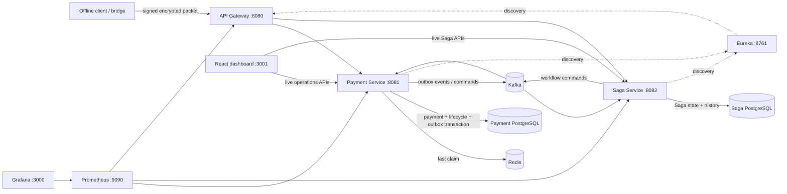

# MeshPay — Offline-First Distributed Payment Infrastructure

### Secure delayed packet synchronization, durable idempotency, and event-driven recovery

MeshPay is a portfolio project for exploring a difficult distributed-systems problem: safely receiving delayed payment packets when clients reconnect, requests race or retry, and services fail between steps.

The system combines signed and encrypted packets, PostgreSQL-backed correctness, Redis coordination, a transactional payment outbox, Kafka consumers, and a persisted Saga workflow. Its React dashboard reads live service data.

> **Scope:** MeshPay is a local engineering demonstration, not a banking ledger, payment processor, or production settlement system. `SETTLED` means the demo Saga completed its local workflow; no external money movement occurs.

| | |
| --- | --- |
| **Backend** | Java 17 · Spring Boot 3.3 · Spring Cloud |
| **Data & messaging** | PostgreSQL 16 · Redis 7 · Kafka 3 / ZooKeeper |
| **Web & operations** | React · TypeScript · Tailwind CSS · Prometheus · Grafana |
| **Run locally** | Docker Compose · Maven Wrapper · JUnit 5 |

## Contents

- [What the project demonstrates](#what-the-project-demonstrates)
- [Architecture](#architecture)
- [Start locally](#start-locally)
- [Configure packet keys](#configure-packet-keys)
- [Packet protocol and security](#packet-protocol-and-security)
- [APIs and dashboard](#apis-and-dashboard)
- [Correctness and delivery semantics](#correctness-and-delivery-semantics)
- [Observability](#observability)
- [Tests and verification](#tests-and-verification)
- [Limitations and next steps](#limitations-and-next-steps)
- [Repository map](#repository-map)

## What the project demonstrates

- **Delayed synchronization:** a client can prepare a packet while disconnected and submit it later. Server acceptance is distinct from settlement.
- **Duplicate safety:** Redis `SET NX` is a fast coordination layer; PostgreSQL unique constraints remain the durable guard.
- **Authenticated packet protection:** AES-256-GCM protects packet contents, RSA-OAEP wraps the one-time AES key, and RSA-PSS verifies the sender separately from encryption.
- **Recoverable payment events:** payment state and its outbox row commit together; publication is at-least-once and consumers deduplicate.
- **Persistent workflow state:** Saga state and transition history are stored in PostgreSQL and coordinated through Kafka.
- **Operational visibility:** the dashboard, Prometheus, and Grafana use service data and metrics rather than demo fixtures.

## Architecture



### Payment lifecycle

```text
created offline → synchronized → validated → settlement requested → settled locally
                                              ↘ rejected / recovery path
```

Offline creation is a client-side concept, not a server-confirmed payment state. The server validates the packet and durably records it before reporting synchronization success. `SETTLED` is the terminal state of this simulated workflow only.

### Local services

| Service | Port | Responsibility |
| --- | ---: | --- |
| API Gateway | 8080 | Routes external HTTP requests to registered services |
| Payment Service | 8081 | Packet verification, payment persistence, idempotency, outbox, metrics |
| Saga Service | 8082 | Persistent orchestration, state transitions, history and event deduplication |
| Eureka | 8761 | Service registry |
| React dashboard | 3001 | Read-only operational views backed by service APIs |
| Prometheus | 9090 | Scrapes service metrics |
| Grafana | 3000 | Provisioned metrics dashboard |
| Payment PostgreSQL | 5433 host | Durable payment, packet, lifecycle and outbox data |
| Saga PostgreSQL | 5434 host | Durable Saga state, history and processed-event records |
| Redis | 6379 | Short-lived idempotency coordination claims |
| Kafka | 9092 host / 29092 Compose | Payment and Saga commands/events |

## Start locally

### Prerequisites

- Docker Desktop with Docker Compose
- Java 17 for Maven tests (the included wrapper downloads/uses Maven)
- Node.js/npm only if you want to run or build the dashboard outside Docker

### Start the stack

```bash
docker compose up --build -d
docker compose ps
```

The payment service runs its Flyway migrations on startup. Named Docker volumes preserve database and monitoring data when containers are recreated. To stop the stack without deleting data:

```bash
docker compose down
```

To intentionally delete local databases, Kafka, Redis and monitoring data, use `docker compose down -v`. This is destructive and not needed for normal upgrades.

### Open the application

- Dashboard: [http://localhost:3001](http://localhost:3001)
- API Gateway: [http://localhost:8080](http://localhost:8080)
- Payment Swagger UI: [http://localhost:8081/swagger-ui.html](http://localhost:8081/swagger-ui.html)
- Saga Swagger UI: [http://localhost:8082/swagger-ui.html](http://localhost:8082/swagger-ui.html)
- Prometheus: [http://localhost:9090](http://localhost:9090)
- Grafana: [http://localhost:3000](http://localhost:3000) (`admin` / `GRAFANA_ADMIN_PASSWORD`)
- Eureka: [http://localhost:8761](http://localhost:8761)

Compose uses the `dev` Spring profile and development-only defaults for local use. Do not expose this setup to the public internet. In particular, replace the sample database, Redis, and Grafana passwords before sharing the environment.

## Configure packet keys

Packet processing intentionally fails closed until the server key pair and a trusted sender key are configured. The recipient-key endpoint returns unavailable until a server public key is provisioned. No private keys are bundled in the repository.

Place configuration in a local, ignored `.env` file (never commit real keys):

| Variable | Required for packet sync | Format |
| --- | --- | --- |
| `MESHPAY_PACKET_RSA_PRIVATE_KEY` | Yes | Base64-encoded DER RSA PKCS#8 server private key |
| `MESHPAY_PACKET_RSA_PUBLIC_KEY` | Yes | Base64-encoded DER X.509 server public key |
| `MESHPAY_PACKET_TRUSTED_SIGNERS` | Yes | `senderVpa=base64(DER X.509 RSA public key)`; multiple entries separated by `;` |
| `MESHPAY_PACKET_MAX_OFFLINE_AGE` | Optional | Maximum age, default `30d` |

Other Compose variables include `DB_USER`, `DB_PASSWORD`, `REDIS_PASSWORD`, `REDIS_PORT`, and `GRAFANA_ADMIN_PASSWORD`. For a secured Spring profile, configure `SPRING_PROFILES_ACTIVE=prod`, `MESHPAY_JWKS_URI`, `MESHPAY_JWT_ISSUER`, and `MESHPAY_JWT_AUDIENCE`; operations and metrics endpoints also require the configured `meshpay:ops` or `meshpay:metrics:read` scope. Use a real identity provider and secret manager. Do not use the unauthenticated development profile in production.

## Packet protocol and security

The synchronization endpoint accepts the `PaymentPacketRequest` envelope. Its encrypted plaintext is the `DecryptedPaymentPacket` model. The sender signs a versioned, newline-delimited canonical envelope containing the protocol label, packet ID, normalized sender VPA, sender nonce, IV, wrapped AES key, and ciphertext.

1. The client encrypts packet JSON with a fresh AES-256 key and AES-256-GCM.
2. The client wraps the AES key with the server RSA public key using OAEP with SHA-256 and MGF1-SHA-256.
3. The sender signs the canonical envelope using RSA-PSS/SHA-256.
4. The service verifies sender trust and signature, unwraps/decrypts the payload, checks the GCM authentication tag, validates identity and packet time, then persists it.

Encryption provides confidentiality and authenticated ciphertext; the separate RSA-PSS signature authenticates the sender. Neither encryption nor signature alone prevents replay. MeshPay additionally tracks sender-plus-nonce replay identity and canonical packet identity in PostgreSQL.

This repository does not include a client wallet, secure hardware key storage, automated signer rotation, or a production key-management service. Key provisioning, private-key protection, signer onboarding/rotation, clock quality, and recipient-key distribution are operator responsibilities.

## APIs and dashboard

Primary APIs (see Swagger UI for request and response schemas):

| Endpoint | Purpose |
| --- | --- |
| `POST /api/payment/packets/sync` | Verify and synchronize an encrypted packet; returns synchronized, duplicate, in-progress, or a sanitized rejection/error |
| `GET /api/payment/packets/recipient-key` | Return the configured packet-encryption public key |
| `GET /api/payment/ops/overview` | Payment and packet summary counters |
| `GET /api/payment/ops/transactions` | Search/list durable payments |
| `GET /api/payment/ops/transactions/{packetId-or-hash}` | Payment and lifecycle details |
| `GET /api/payment/ops/attempts` | Synchronization/validation attempts |
| `GET /api/payment/ops/outbox` | Outbox publication state |
| `GET /api/saga/ops/overview` | Saga summary counters |
| `GET /api/saga/ops/sagas` | Saga list and current states |
| `GET /api/saga/ops/sagas/{sagaId}/history` | Persisted Saga transition history |
| `GET /actuator/health` / `GET /actuator/prometheus` | Health and metrics endpoints |

The React dashboard is read-only. It shows live overview, transaction/synchronization, and reliability information; errors and unavailable data are not displayed as zero. It does not expose private key material or offer retry/replay/admin actions.

## Correctness and delivery semantics

### Idempotency

Payment identity is a SHA-256 hash of a versioned canonical plaintext identity (packet ID, normalized parties, canonical amount/currency, signed time, and nonce). Replay identity is sender plus nonce. Redis `SET NX` with an expiring claim reduces duplicate work; it is not the source of truth. PostgreSQL unique constraints on the canonical packet hash and sender/nonce prevent duplicate durable records if requests race, Redis expires, or Redis is unavailable.

The payment row, lifecycle record, and synchronization outbox row commit in one local database transaction. A duplicate does not create a second payment or synchronization event. These guarantees apply within the defined database and handlers; MeshPay does not claim global exactly-once processing.

### Outbox and Kafka

The Payment Service claims due outbox rows with PostgreSQL `SKIP LOCKED`, waits for Kafka broker acknowledgment before marking publication, and retries with bounded exponential delay. After its configured retry limit it sends the event to a `.DLT` topic. A crash after broker acknowledgment but before the database update may publish the same event again; consumers are expected to deduplicate, so delivery is at-least-once.

Consumers record processed event/command identifiers alongside relevant business state. Listener retries are bounded and repeated failures are routed to dead-letter topics. Dead-letter inspection and replay are manual; no operator recovery console is included.

### Saga boundaries

Saga state and transition history persist in the Saga database. Its local workflow requests validation, requests settlement, and processes local completion/compensation states. Compensation changes MeshPay's local workflow only; it cannot reverse an external financial transfer.

**Known recovery gap:** Saga command publication is synchronous to Kafka acknowledgment but is not backed by a transactional Saga outbox. A process crash after a Saga database commit and before command publication can require operator recovery. This is not hidden behind an exactly-once claim.

## Observability

Prometheus scrapes Payment, Saga, and Gateway Actuator metrics. Custom bounded-cardinality packet, outbox, and Saga metrics are available; the provisioned Grafana dashboard is under `monitoring/grafana/`. No unique payment or packet identifiers are metric labels.

Micrometer OpenTelemetry instrumentation and sampling are configured, but trace propagation/export to a collector has not been verified end-to-end. Local Compose metrics are exposed for development; production deployments need network isolation and appropriate authentication.

## Tests and verification

Run backend tests on Java 17:

```bash
export JAVA_HOME="$(/usr/libexec/java_home -v 17)"  # macOS; set JAVA_HOME to your JDK 17 elsewhere
./mvnw -f meshpay-payment-service/pom.xml clean test
./mvnw -f meshpay-saga-service/pom.xml clean test
./mvnw -f meshpay-api-gateway/pom.xml clean test
./mvnw -f meshpay-eureka-server/pom.xml clean test
```

Build/audit the dashboard:

```bash
cd meshpay-dashboard
npm ci
npm run build
npm audit
```

### Verified on 2026-10-21

- Payment `clean test`: build passed; 4 cryptography unit tests passed. The Testcontainers concurrency test was skipped because the Java test process could not access Docker Desktop's socket.
- Saga, Gateway, and Eureka `clean test`: all builds passed; these modules currently contain no automated tests.
- Dashboard dependency install, production build, and npm audit passed; zero vulnerabilities were reported.
- Payment, Saga, and dashboard Docker images rebuilt; all Compose services started, and Payment/Saga reported healthy. Flyway validated and applied the payment lifecycle migrations against the existing database.
- HTTP checks: Payment, Saga, and Gateway health returned `UP`; dashboard and proxied Payment overview returned HTTP 200. With temporary test keys removed, the recipient-key endpoint correctly returned HTTP 503.
- A live signed/encrypted packet was submitted concurrently 24 times through the Compose stack: 1 `SYNCHRONIZED` (201), 7 `DUPLICATE` (200), 16 `IN_PROGRESS` (202). PostgreSQL contained one durable payment and one synchronization outbox event; Kafka drove one persisted Saga to `SAGA_COMPLETED` and the local workflow to `SETTLED`.

The live concurrency run is evidence for that run, not a performance benchmark or a substitute for running the Testcontainers test in an environment where its JVM can reach Docker. `test-microservices.sh` is a legacy smoke script; it does not provision packet keys or test signed packet synchronization.

## Limitations and next steps

- No real payment rail, external settlement adapter, or monetary ledger.
- No offline wallet/client implementation; this project demonstrates server-side delayed packet synchronization.
- No production key-management service, automated key rotation, or trust-registry onboarding workflow.
- Saga command outbox/recovery is not transactional; dead-letter recovery requires manual operation.
- Testcontainers execution, broad Kafka/DB failure injection, dashboard component tests, and end-to-end OpenTelemetry export remain to be completed.
- Hibernate `ddl-auto: update` remains enabled. Payment lifecycle migrations exist, but a fully migration-managed schema and validate-only mode are future work.
- Compose's `dev` profile and sample passwords are for local development only; this project is not production-hardened or compliance-certified.

## Repository map

```text
meshpay-api-gateway/       Gateway and routing
meshpay-eureka-server/     Service registry
meshpay-payment-service/   Packet security, payment persistence, idempotency, outbox
meshpay-saga-service/      Saga orchestration, history, event deduplication
meshpay-dashboard/         React + TypeScript operations dashboard
monitoring/                Prometheus and Grafana provisioning
docker-compose.yml         Local multi-service environment
```

## License

No license is currently specified. Add a license file before redistribution or reuse.
