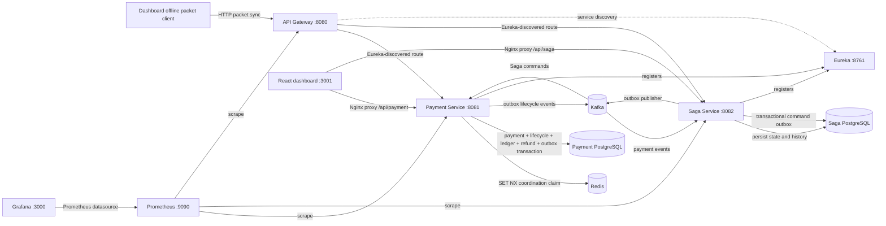

# MeshPay — Offline-First Distributed Payment Engine

### Secure delayed packet synchronization, durable idempotency, and event-driven recovery

MeshPay explores how a backend can safely accept delayed payment packets when clients reconnect, requests race or retry, and distributed services fail between workflow steps. It combines cryptographic packet validation, PostgreSQL-backed idempotency, Redis coordination, Kafka messaging, persisted Saga state, and an operational dashboard.

> **Scope and disclaimer:** MeshPay is a local engineering demonstration, not a banking ledger, payment processor, or production settlement system. `SETTLED` means the demo Saga completed its local workflow; no external money movement occurs.

## Technology stack

| Area | Technologies |
| --- | --- |
| Services | Java 17, Spring Boot 3.3, Spring Cloud, Maven Wrapper |
| Persistence and coordination | PostgreSQL 16, Redis 7, Flyway migrations for Payment and Saga |
| Messaging | Apache Kafka 3, ZooKeeper |
| Packet security | AES-256-GCM, RSA-OAEP, RSA-PSS |
| Dashboard | React, TypeScript, Tailwind CSS, Nginx |
| Operations | Prometheus, Grafana, Micrometer, OpenTelemetry dependencies |
| Load testing | k6 |
| Static analysis | SonarQube Community Edition |
| Infrastructure as code | Terraform (AWS EC2) |
| Local environment and tests | Docker Compose, JUnit 5, Testcontainers (payment integration test) |

## Contents

- [Verified highlights](#verified-highlights)
- [Architecture](#architecture)
- [Payment packet lifecycle](#payment-packet-lifecycle)
- [Services and responsibilities](#services-and-responsibilities)
- [Prerequisites and quick start](#prerequisites-and-quick-start)
- [Environment variables and packet key configuration](#environment-variables-and-packet-key-configuration)
- [Security and packet protocol](#security-and-packet-protocol)
- [API reference](#api-reference)
- [Dashboard](#dashboard)
- [Idempotency and correctness guarantees](#idempotency-and-correctness-guarantees)
- [Transactional outbox and Kafka delivery semantics](#transactional-outbox-and-kafka-delivery-semantics)
- [Saga orchestration and recovery](#saga-orchestration-and-recovery)
- [Observability](#observability)
- [Testing and verification](#testing-and-verification)
- [Load testing (k6)](#load-testing-k6)
- [Static analysis (SonarQube)](#static-analysis-sonarqube)
- [Cloud deployment (Terraform)](#cloud-deployment-terraform)
- [Known limitations and future work](#known-limitations-and-future-work)
- [Repository structure](#repository-structure)
- [License status](#license-status)

## Verified highlights

| Capability | Audit result |
| --- | --- |
| Delayed packet ingestion | Browser client creates Web Crypto packets and persists envelopes in IndexedDB with stable identity and retry/reconnect logic. The production TypeScript build passes; real browser reload and service E2E remain unverified. |
| Packet cryptography | RSA-OAEP/SHA-256 key unwrap, AES-GCM authentication, RSA-PSS/SHA-256 sender verification are implemented. Four cryptography unit tests passed. |
| Idempotency | Redis `SET NX` is used as a short-lived coordination claim; PostgreSQL unique constraints are the durable guard. Redis failure falls back to PostgreSQL. |
| Concurrent duplicates | The 24-request Testcontainers test passed in the final Docker-enabled Java run. A separate live Compose run recorded one durable effect for repeated identical packet submissions. This is correctness evidence, not a benchmark. |
| Financial settlement | Simulated settlement atomically debits/credits accounts under `SELECT ... FOR UPDATE`, writes two append-only `ledger_entries` per payment (unique-constraint enforced), and supports idempotent full refunds with compensating entries. Verified by 8 integration tests including concurrent same-sender settlement. |
| Payment outbox | Implemented for Payment Service with `SKIP LOCKED` claiming, broker-acknowledged publishing, bounded retries, `.DLT` dead-lettering, and authenticated dead-letter inspection/replay endpoints (`/api/payment/ops/outbox/dead`, `/replay/{id}`). |
| Saga | State, transition history, and outgoing command records are persisted. The database row lock coordinates publishers; delivery is at least once and consumer-side command deduplication remains required. Compensation changes local workflow state only. |
| Dashboard | Three operational read-only views plus an IndexedDB offline client are implemented. Packet-state handling is hardened, but browser offline/reload/reconnect acceptance remains unverified. No production login or operator recovery controls are included. |
| Service authentication | Payment, Saga, and Gateway have local signed-JWT/JWKS integration tests for signature, issuer, audience, expiry, and scope behavior. A production identity provider and dashboard login are not configured. |
| Metrics and tracing | Live Prometheus targets returned `up=1`; Grafana's provisioned dashboard API reported five panels and twelve queries. OpenTelemetry export/propagation remains unverified; Compose has no collector configured. |

## Architecture



The dashboard's Nginx proxy talks directly to Payment and Saga APIs; it does not route dashboard calls through the API Gateway. Compose binds published ports to loopback by default. Redis is not the source of payment correctness. Payment and Saga command publication use database outboxes with at-least-once semantics.

## Payment packet lifecycle

```text
Created locally while offline (browser Web Crypto; encrypted envelope stored in IndexedDB)
        ↓ submitted later
Synchronized request → cryptographic/schema/time validation
        ↓ payment row + lifecycle row + outbox row commit together
Durably synchronized → Saga validation → settlement request → settled locally
                                                     ↘ failure / local compensation
```

These states are intentionally distinct:

- **Locally created:** packet exists in the browser IndexedDB queue while disconnected.
- **Synchronized:** the server accepted the request and committed its payment, lifecycle, and initial outbox data.
- **Validated:** a later workflow step accepted the payment according to the demo's server-side rules.
- **Durably accepted:** payment state is committed in PostgreSQL; Redis is only a fast coordination layer.
- **Saga completed / locally settled:** the simulated workflow reached its terminal state. This is not a real-world settlement confirmation.

## Services and responsibilities

| Service | Host port | Responsibility |
| --- | ---: | --- |
| API Gateway | 8080 | Routes `/api/payment/**` and `/api/saga/**` through Eureka; applies configured circuit breakers and fallbacks; requires JWT authentication outside `dev`. |
| Payment Service | 8081 | Packet verification, synchronization, simulated settlement with ledger/refunds, PostgreSQL records, Redis claim, payment outbox, command consumers, dead-letter replay, Actuator metrics. |
| Saga Service | 8082 | Saga state and transition history, event deduplication, workflow commands, compensation state, stuck-state recovery sweeper. |
| Eureka Server | 8761 | Service registry. |
| Dashboard | 3001 | Operational overview, transactions/search, Saga and outbox views, and an IndexedDB offline packet client. |
| Payment PostgreSQL | 5433 | Payment, lifecycle, packet-attempt, processed-command, and outbox data. |
| Saga PostgreSQL | 5434 | Saga states, transitions, and processed-event records. |
| Redis | 6379 | Expiring packet synchronization claims. |
| Kafka / ZooKeeper | 9092 host / 29092 Compose; 2181 | Inter-service commands and payment lifecycle events. |
| Prometheus / Grafana | 9090 / 3000 | Configured metrics scraping and provisioned dashboard. |

## Prerequisites and quick start

Prerequisites: Docker Desktop with Compose. Java 17 is needed for Maven tests; Node.js/npm is only needed to run/build the dashboard outside Docker.

Create a local environment file if you need to override the development defaults (do not commit `.env`):

```bash
cp .env.example .env
```

Packet synchronization remains unavailable until compatible server keys and at least one trusted signer are provisioned.

```bash
docker compose up --build -d
docker compose ps
```

Payment and Saga apply versioned Flyway migrations at startup and run Hibernate in schema-validation mode. Existing databases without Flyway history are baselined and retained; the migration creates any missing tables and indexes. Back up both PostgreSQL databases before an upgrade and verify the backup can be restored. Flyway DDL rollback is not automatic: recovery from a failed migration should restore the backup or use a reviewed forward migration. Compose named volumes are preserved when containers are recreated.

To stop without deleting local data:

```bash
docker compose down
```

To intentionally delete local PostgreSQL, Redis, Kafka, and monitoring volumes:

```bash
docker compose down -v
```

`down -v` is destructive; it is not required for ordinary rebuilds or upgrades.

### Local URLs

| UI / endpoint | URL |
| --- | --- |
| React dashboard | [http://localhost:3001](http://localhost:3001) |
| API Gateway | [http://localhost:8080](http://localhost:8080) |
| Payment Swagger UI | [http://localhost:8081/swagger-ui.html](http://localhost:8081/swagger-ui.html) |
| Saga Swagger UI | [http://localhost:8082/swagger-ui.html](http://localhost:8082/swagger-ui.html) |
| Payment health / metrics | `http://localhost:8081/actuator/health` / `/actuator/prometheus` |
| Saga health / metrics | `http://localhost:8082/actuator/health` / `/actuator/prometheus` |
| Gateway health / metrics | `http://localhost:8080/actuator/health` / `/actuator/prometheus` |
| Prometheus | [http://localhost:9090](http://localhost:9090) |
| Grafana | [http://localhost:3000](http://localhost:3000) |
| SonarQube (opt-in `sonar` profile) | [http://localhost:9000](http://localhost:9000) |
| Eureka | [http://localhost:8761](http://localhost:8761) |

Swagger is available without authentication in the Compose `dev` profile. In a secured profile, endpoints follow service security rules and may require a JWT.

## Environment variables and packet key configuration

Compose defaults to the secured `prod` profile and fails closed unless the JWT issuer, audience, and JWKS URI are configured. The checked-in `.env.example` explicitly selects `dev` for local demonstrations; in that profile Payment, Saga, and Gateway permit unauthenticated requests. Defaults such as `changeme` and `dev-only-change-me` are local-only; do not expose this configuration publicly. Published Compose ports bind to `127.0.0.1`. Compose reads a root `.env` file, which is ignored by `.gitignore`; copy `.env.example` to `.env` only for local development and replace its placeholders.

| Variable | Compose behavior / format |
| --- | --- |
| `SPRING_PROFILES_ACTIVE` | Defaults to `prod`; `.env.example` selects `dev` for local development only. |
| `DB_USER`, `DB_PASSWORD` | PostgreSQL credentials; defaults are `meshpay` / `changeme`. |
| `REDIS_PASSWORD`, `REDIS_PORT` | Redis password and host port; defaults are `changeme` / `6379`. Container-to-container port remains 6379. |
| `GRAFANA_ADMIN_PASSWORD` | Grafana `admin` password; defaults to `dev-only-change-me`. |
| `MESHPAY_PACKET_RSA_PRIVATE_KEY` | Base64-encoded DER RSA PKCS#8 server private key. |
| `MESHPAY_PACKET_RSA_PUBLIC_KEY` | Base64-encoded DER X.509 / SubjectPublicKeyInfo server public key. |
| `MESHPAY_PACKET_TRUSTED_SIGNERS` | Semicolon-delimited `senderVpa=base64(DER X.509 RSA public key)` entries. |
| `MESHPAY_JWKS_URI` | JWKS endpoint for secured Payment/Saga/Gateway profiles. |
| `MESHPAY_JWT_ISSUER`, `MESHPAY_JWT_AUDIENCE` | Required issuer and audience for secured Payment/Saga/Gateway profiles. |

Compose forwards `MESHPAY_PACKET_MAX_OFFLINE_AGE`, `MESHPAY_OUTBOX_MAX_RETRIES`, and `MESHPAY_OUTBOX_ENABLED` to the Payment container. No private keys or trusted signer keys are included in the repository. Key generation, provisioning, onboarding, secure storage, and rotation are operator responsibilities.

For a local demo only, generate independent server-encryption and client-signing keys. The directory is git-ignored. Keep the server private key only in `.env`/a mounted secret and keep the signer private key under the sender's control:

```bash
mkdir -m 700 .local-keys
openssl genpkey -algorithm RSA -pkeyopt rsa_keygen_bits:3072 -out .local-keys/recipient-private.pem
openssl pkey -in .local-keys/recipient-private.pem -pubout -out .local-keys/recipient-public.pem
openssl pkcs8 -topk8 -nocrypt -in .local-keys/recipient-private.pem -outform DER | base64 | tr -d '\n' > .local-keys/recipient-private.pkcs8.b64
openssl pkey -in .local-keys/recipient-public.pem -pubin -outform DER | base64 | tr -d '\n' > .local-keys/recipient-public.spki.b64
openssl genpkey -algorithm RSA -pkeyopt rsa_keygen_bits:3072 -out .local-keys/signer-private.pem
openssl pkey -in .local-keys/signer-private.pem -pubout -out .local-keys/signer-public.pem
openssl pkcs8 -topk8 -nocrypt -in .local-keys/signer-private.pem -outform DER | base64 | tr -d '\n' > .local-keys/signer-private.pkcs8.b64
openssl pkey -in .local-keys/signer-public.pem -pubin -outform DER | base64 | tr -d '\n' > .local-keys/signer-public.spki.b64
```

Copy the Base64 contents of the recipient private/public files into the matching `MESHPAY_PACKET_RSA_*` variables, and configure `MESHPAY_PACKET_TRUSTED_SIGNERS` as `senderVpa=<signer-public.spki.b64 contents>`. Or, when using the documented local `.local-keys` pair, start Compose through `scripts/compose-with-demo-packet-keys.sh`; it adds the `alice@meshpay.local` local signer to existing trusted-signer mappings without editing `.env`. Open the dashboard while online to cache the recipient public key, then import `signer-private.pkcs8.b64` into the Offline Client and use sender `alice@meshpay.local`. The packet-generation helper reads these ignored files and contains no embedded private key. These keys are demo credentials, not managed or rotated keys. The current packet format has no key ID; signer changes require coordinated trusted-key replacement and handling of already queued packets.

Outside `dev`, Payment, Saga, and Gateway require JWT authentication on protected routes and validate configured issuer, audience, and standard token time claims. Operations and metrics routes enforce `meshpay:ops` / `meshpay:metrics:read` scopes. All three services now have integration tests using real signed JWTs and ephemeral local JWKS endpoints. No production identity provider is configured. The dashboard has no token/session integration, so it is intended for the local dev profile unless an authenticated proxy is added. Direct service ports are bound locally by Compose, but non-local deployments still need network policy, TLS, secret management, and hardened operational access.

## Security and packet protocol

Packet envelope and plaintext schemas are defined in:

- `meshpay-payment-service/src/main/java/com/demo/meshpay/payment/api/PaymentPacketRequest.java`
- `meshpay-payment-service/src/main/java/com/demo/meshpay/payment/api/DecryptedPaymentPacket.java`

Verified implementation behavior:

1. Packet contents are encrypted with AES-256-GCM; the service requires a 12-byte IV and verifies the GCM authentication tag during decryption.
2. The AES key is unwrapped with RSA-OAEP using SHA-256 and MGF1-SHA-256. Configured recipient RSA keys must match and be at least 2048 bits.
3. The sender signs a canonical envelope with RSA-PSS/SHA-256. The trusted sender public key is selected from `MESHPAY_PACKET_TRUSTED_SIGNERS`.
4. GCM additional authenticated data binds the protocol label, packet ID, normalized sender, and sender nonce.
5. The service checks decrypted identity against the envelope, validates required payment fields and the accepted time window, and rejects nonce reuse.

Encryption and signatures serve different purposes: encryption provides confidentiality and authenticated ciphertext; RSA-PSS authenticates the packet sender. Neither alone prevents replay. The durable replay guard is sender plus nonce in PostgreSQL. The logical packet hash is SHA-256 over a versioned canonical identity including packet ID, normalized parties, amount, currency, signed time, and nonce; PostgreSQL additionally has unique constraints for packet ID and sender/nonce.

The receiver checks IV length and GCM authentication, but cannot prove that a client generated a fresh random AES key/IV for every encryption. `bridgeNodeId` and `hopCount` are transport metadata and are not included in the canonical signature/AAD; treat them as untrusted. The browser client uses Web Crypto and does not persist its signer's private key, but there is no secure hardware key store, automated trusted-signer lifecycle, production secret manager, or key-rotation procedure.

## API reference

Swagger/OpenAPI is the request-schema reference for the service endpoints.

| Method and path | Purpose |
| --- | --- |
| `POST /api/payment/packets/sync` | Verify and synchronize a signed encrypted packet. `SYNCHRONIZED` → 201, `DUPLICATE` → 200, `IN_PROGRESS` → 202 with `Retry-After`; nonce replay is rejected. |
| `GET /api/payment/packets/recipient-key` | Return the configured server public key; returns unavailable when packet encryption is not configured. |
| `GET /api/payment/ops/overview` | PostgreSQL payment, attempt, duplicate, pending, and outbox counts. |
| `GET /api/payment/ops/transactions` | Recent 100 transactions; API supports `search`, `status`, `from`, and `to` filters. |
| `GET /api/payment/ops/transactions/{identifier}` | Transaction details and lifecycle history by packet ID or canonical hash. |
| `GET /api/payment/ops/attempts` | Recent packet attempts and outcomes. |
| `GET /api/payment/ops/outbox` | Recent outbox publication status and sanitized error code. |
| `GET /api/payment/ops/outbox/dead` | Paginated dead-letter records; optional `topic` filter; metadata only. |
| `POST /api/payment/ops/outbox/replay/{id}` | Replay a dead-lettered outbox row to its original topic (audited). |
| `POST /api/payment/payments/{identifier}/refund` | Full refund of a settled payment; idempotent; writes compensating ledger entries. |
| `GET /api/payment/payments/{identifier}/ledger` | Immutable ledger entries for a payment (by packet ID or hash). |
| `GET /api/payment/refunds` | Recent refund records. |
| `GET /api/saga/ops/overview` | Counts of persisted, completed, compensated, and active Sagas. |
| `GET /api/saga/ops/sagas` | Recent Saga states. |
| `GET /api/saga/ops/sagas/{sagaId}/history` | Persisted Saga transition history. |
| `GET /actuator/health`, `GET /actuator/prometheus` | Service health and metrics (availability depends on profile/security). |

## Dashboard

The React + TypeScript dashboard is served by Nginx on port 3001 and proxies API requests directly to Payment and Saga. Its views are Overview, Transactions, Reliability, and Offline Client. Data refreshes every 15 seconds, and loading/error/empty states distinguish unavailable data from a real zero. A service worker caches only the static dashboard shell and same-origin assets for offline reload; API and health responses are explicitly excluded from its cache.

### Dashboard screenshots

Captured from the live Compose stack (`docker compose up -d`) at `http://localhost:3001`:

<table>
<tr>
<td width="50%">

**Overview** — service health, settlement pipeline, and outbox backlog


</td>
<td width="50%">

**Transactions** — persisted payment records with packet search


</td>
</tr>
<tr>
<td width="50%">

**Reliability** — Saga states and outbox publication health


</td>
<td width="50%">

**Offline Client** — packet creation and IndexedDB queue with retry


</td>
</tr>
</table>

The operational views show aggregate counters, recent transactions with client-side ID/hash search, recent Saga states, and recent outbox events. The Offline Client creates packets while connected or disconnected after recipient key provisioning, stores encrypted envelopes in IndexedDB, retries the same identity after timeouts/reconnection, and displays the server response. It does not persist signer private keys; import the authorized signer's base64 PKCS#8 key per browser session. The operational dashboard still has no production login flow or authorized recovery action controls.

The historical browser HTTP 403 could not be reproduced from retained logs. During the live check, the active profile was `dev`, malformed packet requests returned 400 through Nginx, Payment, and Gateway, and the documented Alice packet initially returned 422 `UNTRUSTED_SENDER` because only `test-sender@meshpay.local` was trusted. The local key launcher now adds Alice while retaining existing signer mappings; the same packet returned 201 and its repeat returned 200. This verifies the present local-demo path, but does not establish the cause of the earlier 403. In the secured profile, packet sync requires a JWT; the dashboard does not yet attach one.

Client transitions are `LOCAL_QUEUED → SYNCING → SYNCHRONIZED | DUPLICATE | IN_PROGRESS | REJECTED`; interrupted/unknown and retryable 5xx/429 outcomes become `RETRY_PENDING`, with exponential retry capped at eight automatic attempts before `FAILED`. A manual retry reuses the stored envelope and identity. `SYNCHRONIZED` and `DUPLICATE` are server ingestion outcomes, not `SETTLED`; settlement comes from the authoritative payment lifecycle/Saga APIs.

Offline client prerequisites: while online, load the server recipient key and import a signer private key whose public key is configured under the sender VPA in `MESHPAY_PACKET_TRUSTED_SIGNERS`. To create offline after reload, the recipient public key is cached in browser local storage; import the signer key again for that browser session. Browser storage is untrusted and can be cleared by the user or browser policy. The server remains authoritative for signature verification, replay checks, idempotency, validation, and payment state.

To build outside Docker:

```bash
cd meshpay-dashboard
npm ci
npm run build
npm audit
```

## Idempotency and correctness guarantees

The canonical logical packet hash is the idempotency key. Redis uses `SET NX` with a 60-second claim lease and caches a committed marker for up to 30 days. A Redis connection error falls back to database processing. PostgreSQL unique constraints on packet hash, packet ID, and `(sender_vpa, nonce)` are the durable duplicate/replay barriers. A stale or expired Redis claim therefore cannot override the database's correctness role.

Payment row, `SYNCHRONIZED` lifecycle record, and initial synchronization outbox row are written in one PostgreSQL transaction. A duplicate request does not create another payment or synchronization outbox row. The transaction commit is the durable acceptance boundary; later validation and local settlement are separate workflow steps.

The Testcontainers test asserts one payment and one outbox effect for 24 concurrent calls and passed in the 2026-11-06 suite run (Payment 25/25). Redis outage, stale-claim recovery, and database rollback paths remain covered only by design review, not executed failure-injection tests.

## Transactional outbox and Kafka delivery semantics

The Payment Service's scheduled outbox processor selects due unprocessed rows in batches with PostgreSQL `FOR UPDATE SKIP LOCKED`. It waits for Kafka's send result before marking a row processed. Failed sends increment retries and use bounded exponential delay; after the configured retry threshold, the publisher sends to a topic suffixed `.DLT` and marks that row processed only if Kafka acknowledges the dead-letter publication.

Delivery is **at least once**. A crash after Kafka acknowledges a message but before the database transaction commits can cause publication again. Payment command consumers and Saga event consumers record processed identifiers in their respective databases within the listener transaction; Kafka listener acknowledgment is record-based. These mechanisms support duplicate delivery handling but are not a proof of globally exactly-once effects.

Dead-lettered rows (published to `<topic>.DLT` after retry exhaustion) can be inspected and replayed through authenticated operations endpoints without manual database edits — see [DLT inspection and replay](#dlt-inspection-and-replay). Replay preserves the original event identity, so consumer-side deduplication still applies; a replayed event cannot create a second durable business effect.

## Saga orchestration and recovery

Saga state and transition history are stored in Saga PostgreSQL. The workflow reacts to packet synchronization, requests validation, requests settlement, processes local completion, or records compensation/failure states. Event deduplication and Saga DB state updates occur in the listener transaction. Transition changes are checked against an explicit allowed-transition table.

Saga transitions and outgoing command records are written in the same Saga PostgreSQL transaction. The scheduled publisher locks due outbox rows, waits for Kafka acknowledgment, retries with bounded exponential delay, and marks exhausted records `DEAD`; the Saga database is the recovery source. A crash after broker acknowledgment and before database commit can cause redelivery. Payment command consumers deduplicate by the stable Saga/action identity. This provides at-least-once publication and effectively-once command handling within the local consumer transaction, not global exactly-once delivery. Compensation records local workflow state only; simulated balances are reversed through refund compensating entries, not saga compensation.

A scheduled recovery sweeper (`SagaRecoveryScheduler`) detects non-terminal sagas whose `updated_at` is older than a configurable timeout (`meshpay.saga.recovery.timeout`, default 10m; interval 60s; max 3 automatic attempts). If the saga has a `DEAD` command-outbox row, the command is requeued once per sweep with its identity unchanged; otherwise the saga is moved to `MANUAL_REVIEW` — it is never auto-settled or auto-compensated, because a timeout cannot prove the payment succeeded or failed. Recovery attempts are persisted on the saga row (`recovery_attempts`, `last_recovery_at`) and counted in Prometheus metrics (`meshpay.saga.recovery.*`). Unit tests cover requeue, manual-review parking, attempt bounds, and per-saga failure isolation.

## Financial settlement, ledger, and refunds

Settlement is **simulated** — no real money moves. When the saga completion command arrives, `PaymentSettlementService` loads sender and receiver `Account` rows under `SELECT ... FOR UPDATE` pessimistic locks, validates positive amount, distinct accounts, and sufficient sender balance, then debits the sender, credits the receiver, updates the transaction to `SETTLED`, and writes two immutable `ledger_entries` rows — all in one database transaction. Insufficient funds or missing accounts reject the payment (`REJECTED`) with no partial financial effect. `BigDecimal`/`NUMERIC(19,2)` is used throughout; balances are never trusted from clients.

`ledger_entries` is append-only: `uk_ledger_entry (packet_hash, account_vpa, direction, kind)` guarantees a payment can never post the same leg twice, and entries are never updated or deleted. `kind` is `SETTLEMENT` or `REFUND`. Account balances are maintained transactionally alongside the ledger (single authoritative balance store; the ledger is the audit trail).

Full refunds are supported via `POST /api/payment/payments/{packetId}/refund`. A refund is eligible only for `SETTLED` payments, is idempotent (`refunds.uk_refund_packet_hash`), writes compensating `REFUND` ledger entries (debit receiver, credit sender), restores balances, marks the transaction `REFUNDED`, and records the request reason and caller identity. Partial refunds are intentionally not implemented.

## DLT inspection and replay

| Endpoint | Description |
|---|---|
| `GET /api/payment/ops/outbox/dead` | Paginated dead-letter list; filter by `topic`; exposes metadata only (never payloads) |
| `POST /api/payment/ops/outbox/replay/{id}` | Resets a dead-lettered row to `processed=false, deadLetter=false, retryCount=0` for republish to its **original** topic; records `replay_count`, `last_replayed_by`, `last_replayed_at` |

Replay rejects missing records (404), non-dead-letter rows, and already-processed rows (409). Because the outbox row keeps its original `event_id` and topic, republished events remain subject to consumer idempotency — replay cannot duplicate a durable business effect.

## Correlation and JWT tooling

HTTP requests carry a correlation ID (`X-Correlation-Id` header or generated UUID) propagated through MDC logging in both services. Kafka consumers extract `sagaId`, `packetHash`, `packetId`, topic/partition/offset into MDC per record via a `RecordInterceptor`, so consumer logs share the originating request's correlation context.

`scripts/mint-dev-token.js` mints development JWTs for exercising the secured (`prod`) profile locally — it is a local dev tool only and is not part of any deployed issuer:

```bash
node scripts/mint-dev-token.js --help
```

## Observability

Prometheus is configured to scrape Payment, Saga, and Gateway Actuator endpoints. Application code registers packet accepted/rejected/duplicate/replay and Redis-fallback counters, Payment/Saga workflow counters and timers, plus outbox/Saga gauges. Grafana provisioning points at Prometheus and includes queries for packet outcomes, outbox backlog/age, payment timing, Saga activity, and scrape health.

In the final live check, Prometheus reported Gateway, Payment, and Saga targets healthy (`up=1`) and returned the Payment packet-acceptance metric. Grafana's health endpoint succeeded and its authenticated read-only API found the provisioned “MeshPay Reliability” dashboard with five panels and twelve PromQL queries. Panel rendering was not visually inspected in a browser. OpenTelemetry bridge/exporter dependencies and sampling settings exist; Compose has no collector service or configured collector endpoint, and cross-service trace export/propagation has not been verified. Resilience4j failure thresholds have not been systematically tested.

## Testing and verification

Run backend tests with Java 17:

```bash
export JAVA_HOME="$(/usr/libexec/java_home -v 17)"  # macOS; set JAVA_HOME manually on other platforms
./mvnw -f meshpay-payment-service/pom.xml clean test
./mvnw -f meshpay-saga-service/pom.xml clean test
./mvnw -f meshpay-api-gateway/pom.xml clean test
./mvnw -f meshpay-eureka-server/pom.xml clean test
```

### Recorded results — 2026-10-21

- Final clean Java 17 module suites passed: Gateway 7/7, Payment 17/17, Saga 12/12, and Eureka built successfully with no test sources. The runs include local signed-JWT/JWKS tests in all three secured services, the 24-request concurrency test, and all three Payment/Saga Testcontainers migration scenarios; none were skipped.
- New disposable-PostgreSQL Flyway tests passed under Java 17: Payment fresh and unversioned non-empty schema scenarios (2/2), Saga fresh and non-empty schema scenario (1/1). The live Compose databases already contained migration history; pre-existing transaction/saga rows remained present after the V4 Payment migration was added to source. These tests use schema snapshots, not a production backup/restore rehearsal.
- The dashboard dependency tree (`npm ls --depth=0`), five packet-response regression tests (`npm test`), production build, and `npm audit --audit-level=low` passed. Vite was updated from 6.4.3 to 6.4.5 for the reported advisory; the audit then found zero vulnerabilities.
- `docker compose config --quiet` passed and `docker compose up --build -d` built the current service/dashboard images. A stale Kafka broker session in the existing ZooKeeper state caused the first start to exit; after the session expired, starting Kafka and then the remaining Compose services succeeded without deleting volumes. All listed containers reached healthy/running states. Payment, Saga, and Gateway health endpoints returned `UP`; Gateway Payment/Saga overview routes returned HTTP 200; the dashboard and its proxied Payment overview returned HTTP 200.
- Prometheus readiness returned HTTP 200 and all three configured scrape targets (Gateway, Payment, Saga) reported `up=1`; the Payment packet acceptance series was present. Grafana's health endpoint returned HTTP 200; the authenticated API found the provisioned dashboard with five panels and twelve queries. Visual rendering was not inspected.
- In a separate manual live Compose check, one valid signed/encrypted packet was submitted 24 times concurrently: 1 `SYNCHRONIZED` (201), 7 `DUPLICATE` (200), 16 `IN_PROGRESS` (202). PostgreSQL showed one durable payment and one synchronization outbox event; Kafka advanced one persisted Saga to `SAGA_COMPLETED`, and the local Payment state reached `SETTLED`.
- In the final controlled local-key check, the documented Alice signer first received `422 UNTRUSTED_SENDER`; the running service trusted only `test-sender@meshpay.local`. The local Compose helper was changed to add Alice without removing the existing signer. The exact previously rejected packet then returned `201 SYNCHRONIZED`, followed by `200 DUPLICATE`. Separate simulated packets were accepted during Kafka unavailability, before a Payment process restart, and while Saga was stopped. PostgreSQL retained committed outbox work, and restarted services processed all events. Aggregate state moved from one pre-existing payment/Saga to six; all six were locally `SETTLED` / `SAGA_COMPLETED`, with no pending outbox rows. No volumes were deleted, and these states represent simulation only.
- Added generated-key signed-JWT/JWKS integration checks at Gateway, Payment, and Saga. Each suite verifies valid scope, insufficient scope, expired token, malformed token, invalid signature, wrong issuer, and wrong audience against a local ephemeral JWKS endpoint. This does not configure or prove a deployed identity provider or dashboard login.

These controlled runtime runs are not a benchmark. Browser-generated Web Crypto acceptance and offline/reload/reconnect behavior remain unverified because no browser was available.

### Recorded results — 2026-11-06 (financial correctness release)

- `./mvnw test -f meshpay-payment-service/pom.xml`: **25/25 pass**, including the new `FinancialCorrectnessIntegrationTest` (8 tests: atomic debit/credit + ledger, repeated settlement, concurrent same-sender settlement, insufficient balance, full refund + compensating entries + idempotent re-refund, unsettled-refund rejection, dead-letter replay reset, replay rejection paths) and both Flyway migration scenarios through V6.
- `./mvnw test -f meshpay-saga-service/pom.xml`: **17/17 pass**, including the new `SagaRecoverySchedulerTest` (5 tests: DEAD-command requeue, MANUAL_REVIEW parking, attempt bound, empty sweep, failure isolation) and the V2 migration scenario.
- `docker compose config --quiet` passed; `docker compose up -d --build` built all images and the full stack reached healthy states (a stale ZooKeeper broker session required one `restart zookeeper kafka`, same as the previous run).
- **Live end-to-end verification**: a freshly generated signed/encrypted packet was submitted through the gateway → `201 SYNCHRONIZED` → saga progressed to `SAGA_COMPLETED` → payment `SETTLED` with `bob@meshpay.local` debited 10.00 and `recipient@meshpay.local` credited 10.00, exactly two `SETTLEMENT` ledger entries. A subsequent `POST .../refund` returned the refund record, a duplicate refund call returned the same `refundId` (idempotent), four balanced ledger entries existed (2 settlement + 2 refund), and balances were restored to 50,000.00 / 0.00.
- This live run exposed and fixed a real defect: `SagaState.recoveryAttempts` needed `@Builder.Default` (Lombok builders bypass field initializers), which had caused `NOT NULL` violations on saga creation in the deployed stack.

### k6 benchmarks — 2026-11-06 (local Compose, Apple Silicon, `grafana/k6` container)

| Script | Offered load | Requests | Failures | p50 | p95 | p99 |
|---|---|---|---|---|---|---|
| `health.js` | 20 it/s × 30s, ramp to 5 VUs | 3,005 | 0% | ~2.5ms | 3.7ms | — |
| `ops-overview.js` | 10 VUs × 30s | 2,650 | 0% | ~10ms | 28.2ms | — |
| `payment-packet-sync.js` | ramp to 20 VUs | 1,782 | 32.7% | ~6ms | 21.6ms | — |
| inline clean run (20 it/s constant) | 20 it/s × 30s | 601 | 0% | ~8ms | 12.4ms | — |

The packet-sync ramp exceeded the `packetSync` Resilience4j rate limit (40 req/s, `timeout-duration: 0`); rejected requests returned `429 RATE_LIMITED` with `Retry-After`. The clean 20 req/s run passed all checks — crypto verification + idempotent persistence sustain ~20 packet/s locally with p95 ≈ 12ms. These are single-machine Compose numbers, not production capacity claims.

Follow-up checks in this workspace: `git diff --check`, `docker compose --env-file /dev/null config --quiet`, `npm ls --depth=0`, and the production dashboard build passed. The browser runtime was unavailable, so browser offline/reload/reconnect acceptance remains unverified.

## Load testing (k6)

k6 scripts live in `load-tests/` and target the local Compose stack. They require the `dev` profile (or a `MESHPAY_TOKEN` JWT against a secured profile):

```bash
# Health endpoints across gateway, payment, saga, eureka, dashboard
k6 run load-tests/health.js

# Read-only ops endpoints through the gateway
k6 run load-tests/ops-overview.js

# Packet synchronization; create packet files first with the Node helper
node scripts/create-payment-packet.js   # writes /tmp/meshpay-packet-<uuid>.json
PACKET_FILE=/tmp/meshpay-packet-<uuid>.json k6 run load-tests/payment-packet-sync.js
```

`payment-packet-sync.js` accepts `PACKET_FILE` (one packet) or `PACKET_FILES` (comma-separated list) and round-robins them. Because each packet carries a one-time sender nonce, repeated identical packets exercise the `DUPLICATE`/`IN_PROGRESS` idempotency paths rather than fresh ingestion; loop `create-payment-packet.js` and pass many files for unique submissions. k6 can also run via Docker: `docker run --rm -i grafana/k6 run - < load-tests/health.js`.

## Static analysis (SonarQube)

SonarQube Community Edition runs as an opt-in Compose service and does not start with the default stack:

```bash
docker compose --profile sonar up -d sonarqube
# UI: http://localhost:9000 (default admin/admin, change on first login)
```

Scanner configuration is in `sonar-project.properties` (Java modules, dashboard sources, tests, exclusions). Run a scan with the helper script, which starts the server if needed:

```bash
SONAR_TOKEN=<user-token> ./scripts/sonar-scan.sh
```

Create the token in SonarQube under **My Account → Security**. For CI, add a `sonar-scanner` step or `mvn sonar:scan` per module pointing at the same host.

## Cloud deployment (Terraform)

`terraform/` provisions a single AWS EC2 instance (Ubuntu 24.04) that installs Docker, clones the repository, writes `.env` from `.env.example` plus any `extra_env` overrides, and runs `docker compose up -d --build` via cloud-init. The security group exposes SSH (restricted by `allowed_ssh_cidrs`) plus dashboard `:3001` and gateway `:8080`.

```bash
cd terraform
cp terraform.tfvars.example terraform.tfvars   # set repo_url and ssh_public_key
terraform init
terraform apply
```

Outputs include the VM public IP and ready-made dashboard/gateway URLs. Note that `.env.example` selects the unauthenticated `dev` profile; use `extra_env` or edit `/opt/meshpay/.env` on the VM for production settings (JWT issuer/audience/JWKS, packet keys). This deploys the Compose stack on one VM; it is not a multi-node or managed-Kubernetes deployment.

## Known limitations and future work

- Browser offline client reload/restart and online-to-offline-to-online end-to-end acceptance has not been executed in an attached browser.
- No real payment rail, external settlement adapter, or real-money movement — all balances and ledger entries are simulated.
- No production key-management service, secure hardware storage, signer onboarding, or automated rotation.
- Saga stuck-state recovery is implemented and unit-tested, but a live stuck-saga recovery demonstration and multi-instance scheduler coordination (e.g., ShedLock) are not yet verified; with multiple Saga replicas the sweeper can race, though transitions are idempotent.
- Dead-letter replay is implemented and integration-tested at the service level; a live Kafka-outage → DLT → replay drill has not been re-run since the endpoints were added.
- Refunds are synchronous and full-amount only; there is no asynchronous refund saga, partial refunds, or refund webhook.
- Redis failure and dashboard component/browser tests remain incomplete.
- OpenTelemetry export and trace propagation are not verified end to end; no collector is included in Compose.
- Payment and Saga use Flyway migrations with Hibernate schema validation; Testcontainers cover fresh and non-empty schema migration. A production backup/restore rehearsal remains an operator task.
- The dashboard has no production authentication integration and does not yet show transaction lifecycle detail/history or authorized recovery controls.
- `.env.example` selects the unauthenticated `dev` profile and contains local placeholders; it must not be exposed publicly. Compose's implicit profile default is now secured `prod`, which requires externally configured JWT settings. TLS termination, production-grade secrets/identity, broker security, network policy, and settlement-provider integration remain deployment requirements. Kafka may require a retry after a previous broker session expires in ZooKeeper; this run recovered without volume deletion.

## Repository structure

```text
meshpay-api-gateway/       HTTP routing and fallbacks
meshpay-eureka-server/     Service registry
meshpay-payment-service/   Packet security, idempotency, ledger, refunds, payment DB, outbox and consumers
meshpay-saga-service/      Persisted Saga state, transitions, consumers, commands and recovery sweeper
meshpay-dashboard/         React + TypeScript operational dashboard
docs/screenshots/          Dashboard screenshots captured from the live Compose stack
monitoring/                Prometheus scrape config and Grafana provisioning/dashboard
load-tests/                k6 load-test scripts
terraform/                 AWS EC2 deployment (cloud-init + docker compose)
sonar-project.properties   SonarQube scanner configuration
docker-compose.yml         Local application and infrastructure stack
```

## License status

No `LICENSE` file is present, so no license has been specified. Select and add a license before redistributing or accepting reuse of this project.
