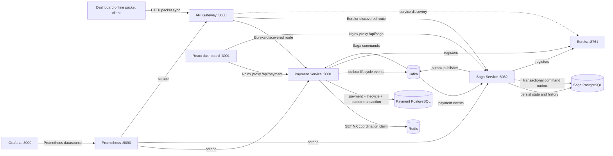

# MeshPay — Offline-First Distributed Payment Engine

### Secure delayed packet synchronization, durable idempotency, and event-driven recovery

MeshPay explores how a backend can safely accept delayed payment packets when clients reconnect, requests race or retry, and distributed services fail between workflow steps. It combines cryptographic packet validation, PostgreSQL-backed idempotency, Redis coordination, Kafka messaging, persisted Saga state, and an operational dashboard.

> **Scope and disclaimer:** MeshPay is a local engineering demonstration, not a banking ledger, payment processor, or production settlement system. `SETTLED` means the demo Saga completed its local workflow; no external money movement occurs.

## Technology stack

| Area | Technologies |
| --- | --- |
| Services | Java 17, Spring Boot 3.3, Spring Cloud, Maven Wrapper |
| Persistence and coordination | PostgreSQL 16, Redis 7, Flyway for payment lifecycle migrations |
| Messaging | Apache Kafka 3, ZooKeeper |
| Packet security | AES-256-GCM, RSA-OAEP, RSA-PSS |
| Dashboard | React, TypeScript, Tailwind CSS, Nginx |
| Operations | Prometheus, Grafana, Micrometer, OpenTelemetry dependencies |
| Local environment and tests | Docker Compose, JUnit 5, Testcontainers (payment integration test) |

## Contents

- [Verified highlights](#verified-highlights)
- [Architecture](#architecture)
- [Payment packet lifecycle](#payment-packet-lifecycle)
- [Services and responsibilities](#services-and-responsibilities)
- [Prerequisites and quick start](#prerequisites-and-quick-start)
- [Environment variables and packet key configuration](#environment-variables-and-packet-key-configuration)
- [Security and packet protocol](#security-and-packet-protocol)
- [API reference](#api-reference)
- [Dashboard](#dashboard)
- [Idempotency and correctness guarantees](#idempotency-and-correctness-guarantees)
- [Transactional outbox and Kafka delivery semantics](#transactional-outbox-and-kafka-delivery-semantics)
- [Saga orchestration and recovery](#saga-orchestration-and-recovery)
- [Observability](#observability)
- [Testing and verification](#testing-and-verification)
- [Known limitations and future work](#known-limitations-and-future-work)
- [Repository structure](#repository-structure)
- [License status](#license-status)

## Verified highlights

| Capability | Audit result |
| --- | --- |
| Delayed packet ingestion | Browser client source now creates Web Crypto packets and persists envelopes in IndexedDB with stable identity and retry/reconnect logic. TypeScript build and browser reload/service E2E remain unverified because npm dependencies could not be fetched in this environment. |
| Packet cryptography | RSA-OAEP/SHA-256 key unwrap, AES-GCM authentication, RSA-PSS/SHA-256 sender verification are implemented. Four cryptography unit tests passed. |
| Idempotency | Redis `SET NX` is used as a short-lived coordination claim; PostgreSQL unique constraints are the durable guard. Redis failure falls back to PostgreSQL. |
| Concurrent duplicates | A 24-request Testcontainers test exists but was skipped in the recorded run because its JVM could not reach Docker. A separate live Compose run on 2026-10-21 recorded one durable payment, one synchronization outbox event, and one completed Saga. This is a single correctness demonstration, not a benchmark. |
| Payment outbox | Implemented for Payment Service. Rows are claimed with `SKIP LOCKED`, published with broker acknowledgment, retried, and eventually sent to a DLT. Failure recovery has not been comprehensively tested. |
| Saga | State, transition history, and outgoing command records are persisted. The database row lock coordinates publishers; delivery is at least once and consumer-side command deduplication remains required. Compensation changes local workflow state only. |
| Dashboard | Three operational read-only views plus an IndexedDB offline client are implemented in source. No production login integration or operator recovery controls are included. |
| Service authentication | Payment, Saga, and Gateway enforce JWT issuer/audience and scope rules outside the `dev` profile. Filter tests cover anonymous, insufficient-scope, and authorized cases; validation against a real identity provider is not verified. |
| Metrics and tracing | Prometheus scrape targets, application metrics, Grafana provisioning, and OpenTelemetry dependencies/configuration exist. Live scrape/panel population and trace export have not been verified end to end. |

## Architecture



The dashboard's Nginx proxy talks directly to Payment and Saga APIs; it does not route dashboard calls through the API Gateway. Compose binds published ports to loopback by default. Redis is not the source of payment correctness. Payment and Saga command publication use database outboxes with at-least-once semantics.

## Payment packet lifecycle

```text
Created locally while offline (browser Web Crypto; encrypted envelope stored in IndexedDB)
        ↓ submitted later
Synchronized request → cryptographic/schema/time validation
        ↓ payment row + lifecycle row + outbox row commit together
Durably synchronized → Saga validation → settlement request → settled locally
                                                     ↘ failure / local compensation
```

These states are intentionally distinct:

- **Locally created:** packet exists in the browser IndexedDB queue while disconnected.
- **Synchronized:** the server accepted the request and committed its payment, lifecycle, and initial outbox data.
- **Validated:** a later workflow step accepted the payment according to the demo's server-side rules.
- **Durably accepted:** payment state is committed in PostgreSQL; Redis is only a fast coordination layer.
- **Saga completed / locally settled:** the simulated workflow reached its terminal state. This is not a real-world settlement confirmation.

## Services and responsibilities

| Service | Host port | Responsibility |
| --- | ---: | --- |
| API Gateway | 8080 | Routes `/api/payment/**` and `/api/saga/**` through Eureka; applies configured circuit breakers and fallbacks; requires JWT authentication outside `dev`. |
| Payment Service | 8081 | Packet verification, synchronization, PostgreSQL records, Redis claim, payment outbox, command consumers, Actuator metrics. |
| Saga Service | 8082 | Saga state and transition history, event deduplication, workflow commands, compensation state. |
| Eureka Server | 8761 | Service registry. |
| Dashboard | 3001 | Read-only overview, recent transactions/search, Saga and outbox views. |
| Payment PostgreSQL | 5433 | Payment, lifecycle, packet-attempt, processed-command, and outbox data. |
| Saga PostgreSQL | 5434 | Saga states, transitions, and processed-event records. |
| Redis | 6379 | Expiring packet synchronization claims. |
| Kafka / ZooKeeper | 9092 host / 29092 Compose; 2181 | Inter-service commands and payment lifecycle events. |
| Prometheus / Grafana | 9090 / 3000 | Configured metrics scraping and provisioned dashboard. |

## Prerequisites and quick start

Prerequisites: Docker Desktop with Compose. Java 17 is needed for Maven tests; Node.js/npm is only needed to run/build the dashboard outside Docker.

Create a local environment file if you need to override the development defaults (do not commit `.env`):

```bash
cp .env.example .env
```

Packet synchronization remains unavailable until compatible server keys and at least one trusted signer are provisioned.

```bash
docker compose up --build -d
docker compose ps
```

The payment service applies Flyway migrations at startup. Compose named volumes preserve local state when containers are recreated.

To stop without deleting local data:

```bash
docker compose down
```

To intentionally delete local PostgreSQL, Redis, Kafka, and monitoring volumes:

```bash
docker compose down -v
```

`down -v` is destructive; it is not required for ordinary rebuilds or upgrades.

### Local URLs

| UI / endpoint | URL |
| --- | --- |
| React dashboard | [http://localhost:3001](http://localhost:3001) |
| API Gateway | [http://localhost:8080](http://localhost:8080) |
| Payment Swagger UI | [http://localhost:8081/swagger-ui.html](http://localhost:8081/swagger-ui.html) |
| Saga Swagger UI | [http://localhost:8082/swagger-ui.html](http://localhost:8082/swagger-ui.html) |
| Payment health / metrics | `http://localhost:8081/actuator/health` / `/actuator/prometheus` |
| Saga health / metrics | `http://localhost:8082/actuator/health` / `/actuator/prometheus` |
| Gateway health / metrics | `http://localhost:8080/actuator/health` / `/actuator/prometheus` |
| Prometheus | [http://localhost:9090](http://localhost:9090) |
| Grafana | [http://localhost:3000](http://localhost:3000) |
| Eureka | [http://localhost:8761](http://localhost:8761) |

Swagger is available without authentication in the Compose `dev` profile. In a secured profile, endpoints follow service security rules and may require a JWT.

## Environment variables and packet key configuration

Compose defaults to `SPRING_PROFILES_ACTIVE=dev`, where Payment, Saga, and Gateway permit unauthenticated requests. Defaults such as `changeme` and `dev-only-change-me` are for local use only; do not expose this configuration publicly. Published Compose ports bind to `127.0.0.1`. Compose reads a root `.env` file, which is ignored by `.gitignore`; copy `.env.example` to `.env` and replace local placeholders as needed.

| Variable | Compose behavior / format |
| --- | --- |
| `SPRING_PROFILES_ACTIVE` | Defaults to `dev`; use a secured profile only after configuring JWT settings. |
| `DB_USER`, `DB_PASSWORD` | PostgreSQL credentials; defaults are `meshpay` / `changeme`. |
| `REDIS_PASSWORD`, `REDIS_PORT` | Redis password and host port; defaults are `changeme` / `6379`. Container-to-container port remains 6379. |
| `GRAFANA_ADMIN_PASSWORD` | Grafana `admin` password; defaults to `dev-only-change-me`. |
| `MESHPAY_PACKET_RSA_PRIVATE_KEY` | Base64-encoded DER RSA PKCS#8 server private key. |
| `MESHPAY_PACKET_RSA_PUBLIC_KEY` | Base64-encoded DER X.509 / SubjectPublicKeyInfo server public key. |
| `MESHPAY_PACKET_TRUSTED_SIGNERS` | Semicolon-delimited `senderVpa=base64(DER X.509 RSA public key)` entries. |
| `MESHPAY_JWKS_URI` | JWKS endpoint for secured Payment/Saga/Gateway profiles. |
| `MESHPAY_JWT_ISSUER`, `MESHPAY_JWT_AUDIENCE` | Required issuer and audience for secured Payment/Saga/Gateway profiles. |

Compose forwards `MESHPAY_PACKET_MAX_OFFLINE_AGE`, `MESHPAY_OUTBOX_MAX_RETRIES`, and `MESHPAY_OUTBOX_ENABLED` to the Payment container. No private keys or trusted signer keys are included in the repository. Key generation, provisioning, onboarding, secure storage, and rotation are operator responsibilities.

For a local demo only, generate independent server-encryption and client-signing keys. The directory is git-ignored. Keep the server private key only in `.env`/a mounted secret and keep the signer private key under the sender's control:

```bash
mkdir -m 700 .local-keys
openssl genpkey -algorithm RSA -pkeyopt rsa_keygen_bits:3072 -out .local-keys/recipient-private.pem
openssl pkey -in .local-keys/recipient-private.pem -pubout -out .local-keys/recipient-public.pem
openssl pkcs8 -topk8 -nocrypt -in .local-keys/recipient-private.pem -outform DER | base64 | tr -d '\n' > .local-keys/recipient-private.pkcs8.b64
openssl pkey -in .local-keys/recipient-public.pem -pubin -outform DER | base64 | tr -d '\n' > .local-keys/recipient-public.spki.b64
openssl genpkey -algorithm RSA -pkeyopt rsa_keygen_bits:3072 -out .local-keys/signer-private.pem
openssl pkey -in .local-keys/signer-private.pem -pubout -out .local-keys/signer-public.pem
openssl pkcs8 -topk8 -nocrypt -in .local-keys/signer-private.pem -outform DER | base64 | tr -d '\n' > .local-keys/signer-private.pkcs8.b64
openssl pkey -in .local-keys/signer-public.pem -pubin -outform DER | base64 | tr -d '\n' > .local-keys/signer-public.spki.b64
```

Copy the Base64 contents of the recipient private/public files into the matching `MESHPAY_PACKET_RSA_*` variables, and configure `MESHPAY_PACKET_TRUSTED_SIGNERS` as `senderVpa=<signer-public.spki.b64 contents>`. Restart Payment Service, open the dashboard while online to cache the recipient public key, and import `signer-private.pkcs8.b64` into the Offline Client. These keys are demo credentials, not managed or rotated keys. The current packet format has no key ID; signer changes require coordinated trusted-key replacement and handling of already queued packets.

Outside `dev`, Payment, Saga, and Gateway require JWT authentication on protected routes and validate configured issuer, audience, and standard token time claims. Operations and metrics routes enforce `meshpay:ops` / `meshpay:metrics:read` scopes. Filter behavior is covered by tests using mocked JWT principals; integration with an actual identity provider and signed token/JWKS rotation is unverified. The dashboard has no token/session integration, so it is intended for the local dev profile unless an authenticated proxy is added. Direct service ports are bound locally by Compose, but non-local deployments still need network policy, TLS, secret management, and hardened operational access.

## Security and packet protocol

Packet envelope and plaintext schemas are defined in:

- `meshpay-payment-service/src/main/java/com/demo/meshpay/payment/api/PaymentPacketRequest.java`
- `meshpay-payment-service/src/main/java/com/demo/meshpay/payment/api/DecryptedPaymentPacket.java`

Verified implementation behavior:

1. Packet contents are encrypted with AES-256-GCM; the service requires a 12-byte IV and verifies the GCM authentication tag during decryption.
2. The AES key is unwrapped with RSA-OAEP using SHA-256 and MGF1-SHA-256. Configured recipient RSA keys must match and be at least 2048 bits.
3. The sender signs a canonical envelope with RSA-PSS/SHA-256. The trusted sender public key is selected from `MESHPAY_PACKET_TRUSTED_SIGNERS`.
4. GCM additional authenticated data binds the protocol label, packet ID, normalized sender, and sender nonce.
5. The service checks decrypted identity against the envelope, validates required payment fields and the accepted time window, and rejects nonce reuse.

Encryption and signatures serve different purposes: encryption provides confidentiality and authenticated ciphertext; RSA-PSS authenticates the packet sender. Neither alone prevents replay. The durable replay guard is sender plus nonce in PostgreSQL. The logical packet hash is SHA-256 over a versioned canonical identity including packet ID, normalized parties, amount, currency, signed time, and nonce; PostgreSQL additionally has unique constraints for packet ID and sender/nonce.

The receiver checks IV length and GCM authentication, but cannot prove that a client generated a fresh random AES key/IV for every encryption. `bridgeNodeId` and `hopCount` are transport metadata and are not included in the canonical signature/AAD; treat them as untrusted. The browser client uses Web Crypto and does not persist its signer's private key, but there is no secure hardware key store, automated trusted-signer lifecycle, production secret manager, or key-rotation procedure.

## API reference

Swagger/OpenAPI is the request-schema reference for the service endpoints.

| Method and path | Purpose |
| --- | --- |
| `POST /api/payment/packets/sync` | Verify and synchronize a signed encrypted packet. `SYNCHRONIZED` → 201, `DUPLICATE` → 200, `IN_PROGRESS` → 202 with `Retry-After`; nonce replay is rejected. |
| `GET /api/payment/packets/recipient-key` | Return the configured server public key; returns unavailable when packet encryption is not configured. |
| `GET /api/payment/ops/overview` | PostgreSQL payment, attempt, duplicate, pending, and outbox counts. |
| `GET /api/payment/ops/transactions` | Recent 100 transactions; API supports `search`, `status`, `from`, and `to` filters. |
| `GET /api/payment/ops/transactions/{identifier}` | Transaction details and lifecycle history by packet ID or canonical hash. |
| `GET /api/payment/ops/attempts` | Recent packet attempts and outcomes. |
| `GET /api/payment/ops/outbox` | Recent outbox publication status and sanitized error code. |
| `GET /api/saga/ops/overview` | Counts of persisted, completed, compensated, and active Sagas. |
| `GET /api/saga/ops/sagas` | Recent Saga states. |
| `GET /api/saga/ops/sagas/{sagaId}/history` | Persisted Saga transition history. |
| `GET /actuator/health`, `GET /actuator/prometheus` | Service health and metrics (availability depends on profile/security). |

## Dashboard

The React + TypeScript dashboard is served by Nginx on port 3001 and proxies API requests directly to Payment and Saga. Its views are Overview, Transactions, Reliability, and Offline Client. Data refreshes every 15 seconds, and loading/error/empty states distinguish unavailable data from a real zero.

The operational views show aggregate counters, recent transactions with client-side ID/hash search, recent Saga states, and recent outbox events. The Offline Client creates packets while connected or disconnected after recipient key provisioning, stores encrypted envelopes in IndexedDB, retries the same identity after timeouts/reconnection, and displays the server response. It does not persist signer private keys; import the authorized signer's base64 PKCS#8 key per browser session. The operational dashboard still has no production login flow or authorized recovery action controls.

Client transitions are `LOCAL_QUEUED → SYNCING → SYNCHRONIZED | DUPLICATE | IN_PROGRESS | REJECTED`; interrupted/unknown and retryable 5xx/429 outcomes become `RETRY_PENDING`, with exponential retry capped at eight automatic attempts before `FAILED`. A manual retry reuses the stored envelope and identity. `SYNCHRONIZED` and `DUPLICATE` are server ingestion outcomes, not `SETTLED`; settlement comes from the authoritative payment lifecycle/Saga APIs.

Offline client prerequisites: while online, load the server recipient key and import a signer private key whose public key is configured under the sender VPA in `MESHPAY_PACKET_TRUSTED_SIGNERS`. To create offline after reload, the recipient public key is cached in browser local storage; import the signer key again for that browser session. Browser storage is untrusted and can be cleared by the user or browser policy. The server remains authoritative for signature verification, replay checks, idempotency, validation, and payment state.

To build outside Docker:

```bash
cd meshpay-dashboard
npm ci
npm run build
npm audit
```

## Idempotency and correctness guarantees

The canonical logical packet hash is the idempotency key. Redis uses `SET NX` with a 60-second claim lease and caches a committed marker for up to 30 days. A Redis connection error falls back to database processing. PostgreSQL unique constraints on packet hash, packet ID, and `(sender_vpa, nonce)` are the durable duplicate/replay barriers. A stale or expired Redis claim therefore cannot override the database's correctness role.

Payment row, `SYNCHRONIZED` lifecycle record, and initial synchronization outbox row are written in one PostgreSQL transaction. A duplicate request does not create another payment or synchronization outbox row. The transaction commit is the durable acceptance boundary; later validation and local settlement are separate workflow steps.

The Testcontainers test asserts one payment and one outbox effect for 24 concurrent calls, but it was skipped in the recorded Maven run. The manual live run provides evidence for that single run only; Redis outage, stale-claim recovery, database rollback, and high-load behavior are not covered by executed automated tests.

## Transactional outbox and Kafka delivery semantics

The Payment Service's scheduled outbox processor selects due unprocessed rows in batches with PostgreSQL `FOR UPDATE SKIP LOCKED`. It waits for Kafka's send result before marking a row processed. Failed sends increment retries and use bounded exponential delay; after the configured retry threshold, the publisher sends to a topic suffixed `.DLT` and marks that row processed only if Kafka acknowledges the dead-letter publication.

Delivery is **at least once**. A crash after Kafka acknowledges a message but before the database transaction commits can cause publication again. Payment command consumers and Saga event consumers record processed identifiers in their respective databases within the listener transaction; Kafka listener acknowledgment is record-based. These mechanisms support duplicate delivery handling but are not a proof of globally exactly-once effects. DLT inspection/replay is manual, and DLT/consumer recovery is not covered by integration tests.

## Saga orchestration and recovery

Saga state and transition history are stored in Saga PostgreSQL. The workflow reacts to packet synchronization, requests validation, requests settlement, processes local completion, or records compensation/failure states. Event deduplication and Saga DB state updates occur in the listener transaction. Transition changes are checked against an explicit allowed-transition table.

Saga transitions and outgoing command records are written in the same Saga PostgreSQL transaction. The scheduled publisher locks due outbox rows, waits for Kafka acknowledgment, retries with bounded exponential delay, and marks exhausted records `DEAD`; the Saga database is the recovery source. A crash after broker acknowledgment and before database commit can cause redelivery. Payment command consumers deduplicate by the stable Saga/action identity. This provides at-least-once publication and effectively-once command handling within the local consumer transaction, not global exactly-once delivery. Compensation records local workflow state only; no external transfer exists to reverse. Outbox recovery has unit coverage for stable command IDs and retry exhaustion, but database/Kafka crash injection remains unverified.

## Observability

Prometheus is configured to scrape Payment, Saga, and Gateway Actuator endpoints. Application code registers packet accepted/rejected/duplicate/replay and Redis-fallback counters, Payment/Saga workflow counters and timers, plus outbox/Saga gauges. Grafana provisioning points at Prometheus and includes queries for packet outcomes, outbox backlog/age, payment timing, Saga activity, and scrape health.

These configurations and metric definitions are present, but populated Prometheus/Grafana panels were not independently verified in the recorded run. OpenTelemetry bridge/exporter dependencies and sampling settings exist; Compose has no collector service or configured collector endpoint, and cross-service trace export/propagation has not been verified end to end. Resilience4j packet rate limiting and Gateway circuit-breaker routes are configured; failure/threshold behavior has not been systematically tested.

## Testing and verification

Run backend tests with Java 17:

```bash
export JAVA_HOME="$(/usr/libexec/java_home -v 17)"  # macOS; set JAVA_HOME manually on other platforms
./mvnw -f meshpay-payment-service/pom.xml clean test
./mvnw -f meshpay-saga-service/pom.xml clean test
./mvnw -f meshpay-api-gateway/pom.xml clean test
./mvnw -f meshpay-eureka-server/pom.xml clean test
```

### Recorded results — 2026-10-21

- Payment `clean test`: 12 tests run, 11 passed and the Testcontainers concurrency test was **skipped** because the Java test process could not access the Docker Desktop socket. Coverage includes four packet-cryptography cases, service-level idempotency fallback/error behavior, and production-profile security filters.
- Saga `clean test` baseline: 6 tests passed. After Saga outbox implementation, `mvn -f meshpay-saga-service/pom.xml test`: 8 tests passed, including stable outbox command identity and retry exhaustion. Gateway baseline: 4 security-filter tests passed. Eureka built successfully and has no test sources.
- Dashboard `npm ci`, production build, and `npm audit`: passed; npm reported zero vulnerabilities.
- `docker compose config --quiet` passed and `docker compose up --build -d` built the current service/dashboard images. A stale Kafka broker session in the existing ZooKeeper state caused the first start to exit; after the session expired, starting Kafka and then the remaining Compose services succeeded without deleting volumes. All listed containers reached healthy/running states. Payment, Saga, and Gateway health endpoints returned `UP`; Gateway Payment/Saga overview routes returned HTTP 200; the dashboard and its proxied Payment overview returned HTTP 200.
- Prometheus readiness returned HTTP 200 and all three configured scrape targets (Gateway, Payment, Saga) reported `up`. The Payment `/actuator/prometheus` endpoint exposed real HTTP and MeshPay outbox metrics. Grafana's health endpoint returned HTTP 200; dashboard panel rendering/population was not manually inspected.
- In a separate manual live Compose check, one valid signed/encrypted packet was submitted 24 times concurrently: 1 `SYNCHRONIZED` (201), 7 `DUPLICATE` (200), 16 `IN_PROGRESS` (202). PostgreSQL showed one durable payment and one synchronization outbox event; Kafka advanced one persisted Saga to `SAGA_COMPLETED`, and the local Payment state reached `SETTLED`.

The manual run is not a benchmark and has no committed packet-generator script or repeatable E2E test harness. The Testcontainers result remains skipped. `test-microservices.sh` is a legacy smoke script; it does not provision packet keys or exercise signed packet synchronization.

Follow-up checks in this workspace: Java 17 Saga tests passed (8/8); `git diff --check` passed; `docker compose config --quiet` passed. Dashboard `npm ci` could not complete because DNS lookup for `registry.npmjs.org` failed (`ENOTFOUND`); `npm ci --offline` also failed because TypeScript 5.7.2 is not cached (`ENOTCACHED`). Therefore the new offline client has not been compiled or exercised in a browser here. Docker Compose runtime inspection was blocked by permission denied on the Docker Desktop socket. The current process did not rerun or independently reproduce the previously recorded manual Compose checks above.

## Known limitations and future work

- Browser offline client reload/restart and online-to-offline-to-online end-to-end acceptance has not been executed.
- No real payment rail, external settlement adapter, or monetary ledger.
- No production key-management service, secure hardware storage, signer onboarding, or automated rotation.
- Saga outbox database/Kafka crash recovery and dead-letter operator recovery are not integration tested; dead rows currently require database operator intervention.
- Testcontainers concurrency execution, broader DB/Kafka/Redis failure injection, Saga tests, and dashboard component tests remain incomplete.
- OpenTelemetry export and trace propagation are not verified end to end; no collector is included in Compose.
- Hibernate `ddl-auto: update` remains enabled. Payment lifecycle migrations exist, but the full schema is not migration-managed and validate-only mode is not enabled.
- The dashboard has no production authentication integration and does not yet show transaction lifecycle detail/history or authorized recovery controls.
- Compose development defaults, plaintext local broker connections, and sample credentials are not production-hardened. Published host ports bind to loopback, but this is not a substitute for deployment network controls. Kafka may require a retry after a previous broker session expires in ZooKeeper; this run recovered without volume deletion.

## Repository structure

```text
meshpay-api-gateway/       HTTP routing and fallbacks
meshpay-eureka-server/     Service registry
meshpay-payment-service/   Packet security, idempotency, payment DB, outbox and consumers
meshpay-saga-service/      Persisted Saga state, transitions, consumers and commands
meshpay-dashboard/         React + TypeScript operational dashboard
monitoring/                Prometheus scrape config and Grafana provisioning/dashboard
docker-compose.yml         Local application and infrastructure stack
test-microservices.sh      Legacy smoke script (not a packet-sync E2E test)
```

## License status

No `LICENSE` file is present, so no license has been specified. Select and add a license before redistributing or accepting reuse of this project.
