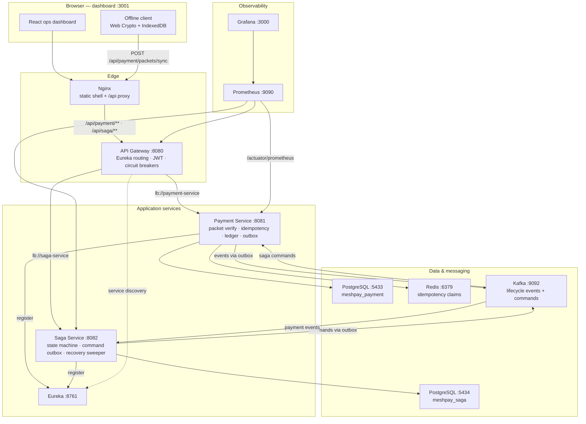

# MeshPay

### An offline-first, event-driven payment engine with cryptographic packet sync, durable idempotency, and saga orchestration.

MeshPay is a distributed payment backend that safely accepts payment packets created on disconnected clients, synchronizes them exactly once when connectivity returns, and drives them through a multi-step settlement workflow built on Kafka, PostgreSQL transactional outboxes, Redis coordination, and persisted Saga state — shipped with an operational dashboard and a browser-based offline client.

> **Scope:** MeshPay is a local engineering demonstration, not a bank or payment processor. Settlement, balances, and ledger entries are simulated — no real money moves and no external payment rail is integrated.

---

## Contents

- [Overview](#overview)
- [Key features](#key-features)
- [Architecture](#architecture)
- [Payment lifecycle](#payment-lifecycle)
- [Technology stack](#technology-stack)
- [Quick start](#quick-start)
- [Packet key setup](#packet-key-setup-local-demo)
- [Environment variables](#environment-variables)
- [API surface](#api-surface)
- [Engineering decisions](#engineering-decisions-and-reliability-mechanisms)
- [Testing & verification](#testing--verification)
- [Dashboard](#dashboard)
- [Static analysis & deployment](#static-analysis-and-deployment)
- [Known limitations](#known-limitations)
- [Repository layout](#repository-layout)

## Overview

The core problem MeshPay addresses is *delayed, unreliable ingestion*: a client may create a payment while offline, retry after timeouts, or submit the same packet concurrently from multiple attempts. Naive ingestion double-spends, double-posts, or silently loses payments.

MeshPay's answer is layered:

1. **Client-side cryptography** — the browser encrypts each payment into a signed envelope (AES-256-GCM payload, RSA-OAEP key wrap, RSA-PSS signature) and persists it in IndexedDB until acknowledged.
2. **Server-side verification** — the Payment Service authenticates the envelope, unwraps the key, decrypts, validates fields and the offline time window, then commits payment + lifecycle + outbox rows in one PostgreSQL transaction.
3. **Durable idempotency** — Redis `SET NX` claims coordinate fast-path duplicates; PostgreSQL unique constraints (`packet_hash`, `packet_id`, `(sender_vpa, nonce)`) are the authoritative barrier.
4. **Event-driven settlement** — lifecycle events flow through Kafka via transactional outboxes; a Saga service orchestrates *validate → settle → complete* with persisted state, transition history, deduplication, and a stuck-saga recovery sweeper.
5. **Financial correctness** — simulated settlement debits/credits accounts under `SELECT … FOR UPDATE` and posts append-only ledger entries; full refunds write compensating entries idempotently.

## Key features

| Capability | Implementation |
| --- | --- |
| Offline payment packets | Browser Web Crypto creates AES-256-GCM / RSA-OAEP / RSA-PSS envelopes; IndexedDB queue with stable identity, exponential retry, and manual reconciliation |
| Exactly-once ingestion | Redis claim + PostgreSQL unique constraints + canonical `SHA-256` packet hash; 24 concurrent duplicate submissions produce one durable payment |
| Transactional outbox | `FOR UPDATE SKIP LOCKED` claiming, broker-acknowledged publish, bounded exponential retry, `.DLT` dead-lettering, audited replay API |
| Saga orchestration | Persisted state machine with explicit transition table, transition history, command outbox, event deduplication, conservative stuck-saga recovery (`MANUAL_REVIEW`, never auto-settle) |
| Simulated ledger | Pessimistic account locking, append-only `ledger_entries` with unique-leg constraint, `BigDecimal` / `NUMERIC(19,2)`, full idempotent refunds |
| Service security | JWT resource-server validation (JWKS, issuer, audience, `meshpay:ops` / `meshpay:metrics:read` scopes) outside the `dev` profile, in all three services |
| Resilience | Resilience4j circuit breakers, rate limiting, and retries at gateway and payment boundaries |
| Observability | Micrometer / Prometheus metrics, Grafana dashboard provisioning, correlation-ID propagation through HTTP and Kafka consumers |
| Operations UI | React + TypeScript dashboard (Overview, Transactions, Reliability, Offline Client) behind Nginx with a shell-only service worker |
| Dev tooling | k6 load tests, SonarQube profile, `scripts/mint-dev-token.js` JWKS/JWT dev issuer, Terraform EC2 deployment |

## Architecture



All dashboard API traffic goes through the gateway (`api-gateway:8080`), so it gets Eureka routing and — outside `dev` — JWT enforcement. Service health checks proxy directly to each service's `/actuator/health`. Compose binds every published port to `127.0.0.1`.

## Payment lifecycle

```text
Browser (offline)              Payment Service                 Kafka               Saga Service
─────────────────             ────────────────               ─────               ─────────────
create packet
AES-GCM encrypt
RSA-OAEP wrap key
RSA-PSS sign
store in IndexedDB
      │  on reconnect
      ▼
POST /packets/sync ──────► verify signature → unwrap key →
                          AES-GCM decrypt + AAD →
                          validate fields, time window,
                          nonce replay check
                          │ one DB transaction:
                          │  transaction + lifecycle + outbox
                          ▼
                     SYNCHRONIZED ──outbox──► payment-packet-synchronized
                                                                │ create saga +
                                                                │ queue VALIDATE
                     ◄── saga-validate-payment-command ──────────┘
                     VALIDATED ──outbox──► payment-validated ──► queue REQUEST_SETTLEMENT
                     ◄── saga-request-settlement-command ─────────────────────────┘
                     SETTLEMENT_REQUESTED ──► payment-settlement-requested ──► queue COMPLETE_SETTLEMENT
                     ◄── saga-complete-settlement-command ────────────────────────────────┘
                     SETTLED (atomic debit/credit + 2 ledger entries)
                     ──outbox──► payment-settled ──► SAGA_COMPLETED
                     any failure ──► payment-failed ──► saga compensation (SAGA_COMPENSATED)
```

States are deliberately distinct — a queued or synchronized packet is **not** a settled payment:

| Stage | Meaning |
| --- | --- |
| `LOCAL_QUEUED` / `RETRY_PENDING` | Client-side IndexedDB state; not yet accepted by the server |
| `SYNCHRONIZED` | Durably committed in PostgreSQL; Redis played no correctness role |
| `VALIDATED` → `SETTLEMENT_REQUESTED` → `SETTLED` | Server lifecycle driven by saga commands |
| `REJECTED` / `REFUNDED` | Terminal failure / compensated-by-refund states |
| `SAGA_COMPLETED` | Local demo workflow finished — **not** a real-world settlement |

## Technology stack

| Layer | Technology |
| --- | --- |
| Services | Java 17 · Spring Boot 3.3.5 · Spring Cloud 2023.0.3 (Gateway, Eureka) · Maven Wrapper |
| Data | PostgreSQL 16 (one DB per service) · Flyway migrations · Hibernate `validate` |
| Coordination | Redis 7 — `SET NX` claims with Lua release/complete scripts |
| Messaging | Apache Kafka 3 (Confluent 7.5 images, ZooKeeper) |
| Packet crypto | AES-256-GCM · RSA-OAEP (SHA-256/MGF1) · RSA-PSS (SHA-256) · Web Crypto on the client |
| Resilience | Resilience4j circuit breakers, rate limiter, retry |
| Security | Spring Security OAuth2 resource server, JWKS JWT validation |
| Frontend | React 18 · TypeScript · Vite 6 · Tailwind CSS 4 · Nginx |
| Observability | Micrometer · Prometheus · Grafana (provisioned) · OpenTelemetry deps (no collector configured) |
| Testing | JUnit 5 · Mockito · Testcontainers · Node test runner · k6 |
| Analysis / IaC | SonarQube CE (opt-in profile) · Terraform (single AWS EC2 + cloud-init) |

## Quick start

**Prerequisites:** Docker Desktop with Compose (full stack) · Java 17 (Maven tests) · Node.js 20+ (dashboard/scripts only) · k6 and Terraform optional.

```bash
cp .env.example .env        # local dev profile — never commit .env
docker compose up --build -d
docker compose ps           # wait for healthy
```

| URL | Purpose |
| --- | --- |
| http://localhost:3001 | Dashboard |
| http://localhost:8080 | API Gateway |
| http://localhost:8081/swagger-ui.html | Payment API docs |
| http://localhost:8082/swagger-ui.html | Saga API docs |
| http://localhost:9090 · :3000 | Prometheus · Grafana (`admin` / `GRAFANA_ADMIN_PASSWORD`) |
| http://localhost:8761 | Eureka |
| http://localhost:9000 | SonarQube — only with `--profile sonar` |

- Stop without losing data: `docker compose down`
- Wipe local volumes (PostgreSQL, Redis, Kafka, monitoring): `docker compose down -v` — destructive
- Payment and Saga apply Flyway migrations at startup (Hibernate `validate` mode); unversioned legacy databases are baselined and migrated forward. **Back up both databases before upgrading** — Flyway DDL rollback is not automatic.

## Packet key setup (local demo)

Packet sync requires a server RSA keypair and at least one trusted sender public key. `.local-keys/` is git-ignored; generate a demo pair:

```bash
mkdir -m 700 .local-keys
openssl genpkey -algorithm RSA -pkeyopt rsa_keygen_bits:3072 -out .local-keys/recipient-private.pem
openssl pkey -in .local-keys/recipient-private.pem -pubout -out .local-keys/recipient-public.pem
openssl pkcs8 -topk8 -nocrypt -in .local-keys/recipient-private.pem -outform DER | base64 | tr -d '\n' > .local-keys/recipient-private.pkcs8.b64
openssl pkey -in .local-keys/recipient-public.pem -pubin -outform DER | base64 | tr -d '\n' > .local-keys/recipient-public.spki.b64
openssl genpkey -algorithm RSA -pkeyopt rsa_keygen_bits:3072 -out .local-keys/signer-private.pem
openssl pkey -in .local-keys/signer-private.pem -pubout -out .local-keys/signer-public.pem
openssl pkcs8 -topk8 -nocrypt -in .local-keys/signer-private.pem -outform DER | base64 | tr -d '\n' > .local-keys/signer-private.pkcs8.b64
openssl pkey -in .local-keys/signer-public.pem -pubin -outform DER | base64 | tr -d '\n' > .local-keys/signer-public.spki.b64
```

Then either put the values into `.env` (`MESHPAY_PACKET_RSA_PRIVATE_KEY`, `MESHPAY_PACKET_RSA_PUBLIC_KEY`, `MESHPAY_PACKET_TRUSTED_SIGNERS=alice@meshpay.local=<signer-public.spki.b64>`), or run `scripts/compose-with-demo-packet-keys.sh` — it exports the keys and adds the `alice@meshpay.local` signer without editing `.env`.

In the dashboard's **Offline Client** tab: load the recipient key while online, import `signer-private.pkcs8.b64` (held in memory only, never persisted), and create packets. A CLI generator is also available: `node scripts/create-payment-packet.js` (writes `/tmp/meshpay-packet-<uuid>.json`).

These are demo credentials — no KMS, HSM, rotation, or signer onboarding exists.

## Environment variables

Compose reads the root `.env` (git-ignored). `.env.example` selects `dev`, which permits unauthenticated access — **local use only**. Compose defaults to `prod` when `SPRING_PROFILES_ACTIVE` is unset, which **fails closed**: Payment, Saga, and Gateway refuse to start without `MESHPAY_JWKS_URI`, `MESHPAY_JWT_ISSUER`, and `MESHPAY_JWT_AUDIENCE`.

| Variable | Purpose |
| --- | --- |
| `SPRING_PROFILES_ACTIVE` | `dev` (permit-all) or anything else (JWT required). Compose default: `prod` |
| `DB_USER` / `DB_PASSWORD` | PostgreSQL credentials (local defaults are placeholders) |
| `REDIS_PASSWORD` / `REDIS_PORT` | Redis auth and host port |
| `GRAFANA_ADMIN_PASSWORD` | Grafana admin password |
| `MESHPAY_PACKET_RSA_PRIVATE_KEY` / `MESHPAY_PACKET_RSA_PUBLIC_KEY` | Base64 DER PKCS#8 / X.509 recipient key pair — both or neither |
| `MESHPAY_PACKET_TRUSTED_SIGNERS` | `senderVpa=base64(DER SPKI)` entries, `;`-separated |
| `MESHPAY_PACKET_MAX_OFFLINE_AGE` | Accepted offline window (default `30d`) |
| `MESHPAY_OUTBOX_MAX_RETRIES` / `MESHPAY_OUTBOX_ENABLED` | Payment outbox retry bound / toggle |
| `SAGA_RECOVERY_TIMEOUT` / `SAGA_RECOVERY_INTERVAL_MS` / `SAGA_RECOVERY_MAX_ATTEMPTS` | Stuck-saga sweeper tuning (defaults `PT10M` / `60000` / `3`) |
| `MESHPAY_JWKS_URI` / `MESHPAY_JWT_ISSUER` / `MESHPAY_JWT_AUDIENCE` | Required outside `dev` |

**Dev JWT tooling:** `node scripts/mint-dev-token.js` runs a throwaway JWKS issuer and mints RS256 tokens for exercising the secured profile locally:

```bash
node scripts/mint-dev-token.js serve            # JWKS on :8799
node scripts/mint-dev-token.js mint --role ADMIN
# then set MESHPAY_JWKS_URI=http://localhost:8799/.well-known/jwks.json
#      MESHPAY_JWT_ISSUER=meshpay-dev  MESHPAY_JWT_AUDIENCE=meshpay
```

Dev-only — no production IdP is configured.

## API surface

Full request schemas: Swagger UI at `:8081/swagger-ui.html` and `:8082/swagger-ui.html` (open in `dev`; JWT-protected otherwise). Key endpoints via the gateway (`:8080`) or directly:

| Endpoint | Purpose |
| --- | --- |
| `POST /api/payment/packets/sync` | Verify + ingest an encrypted packet → `201 SYNCHRONIZED`, `200 DUPLICATE`, `202 IN_PROGRESS` (+`Retry-After`); rate-limited at 40 req/s |
| `GET /api/payment/packets/recipient-key` | Server RSA public key for packet encryption |
| `GET /api/payment/ops/{overview,transactions,transactions/{id},attempts,outbox}` | Read-only operational views backed by PostgreSQL |
| `GET /api/payment/ops/outbox/dead` · `POST …/replay/{id}` | Dead-letter inspection and audited replay to the original topic |
| `POST /api/payment/payments/{id}/refund` · `GET …/ledger` · `GET /api/payment/refunds` | Full idempotent refund, immutable ledger, refund list |
| `POST /api/payment/{validate,settlement/request,settlement/complete,failure}` | Saga command handlers (Kafka-consumed; directly callable in dev) |
| `GET /api/saga/ops/{overview,sagas,sagas/{id}/history,outbox,outbox/overview}` | Saga state, transition history, command outbox health |
| `POST /api/saga/{start,validate,settlement/request,settlement/complete}` | Manual saga drivers |
| `GET /actuator/health` · `/actuator/prometheus` | Health and metrics (scope-gated outside `dev`) |

## Engineering decisions and reliability mechanisms

- **Idempotency is layered, not single-point.** Redis claims are a fast-path optimization with 60-second leases; a Redis outage falls back to PostgreSQL, and unique constraints remain authoritative. Nonce replay is rejected (`409 NONCE_REPLAY`) even when packet content differs.
- **Transactional outbox on both sides.** Payment lifecycle events and Saga commands commit in the same DB transaction as the state change, then publish via schedulers that wait for Kafka acknowledgment. Delivery is **at-least-once**; consumer-side dedup (`processed_events`, `processed_commands`, stable command IDs) makes effects effectively-once within the local transaction.
- **Dead-letter with operator replay.** Exhausted retries publish to `<topic>.DLT`; ops endpoints list metadata only (never payloads) and replay preserving `event_id`, so replayed events remain subject to consumer dedup.
- **Conservative saga recovery.** `SagaRecoveryScheduler` requeues `DEAD` commands once per sweep (bounded by `recovery_attempts`) or parks the saga in `MANUAL_REVIEW` — it never auto-settles or auto-compensates, because a timeout cannot prove the payment outcome.
- **Append-only financial records.** `ledger_entries` is insert-only with a unique `(packet_hash, account_vpa, direction, kind)` constraint — a payment leg can never post twice. Refunds write `REFUND` compensating entries instead of mutating settlement history.
- **Fail-closed security.** Outside `dev`, missing JWT configuration prevents startup; ops/metrics scopes are enforced per route at both gateway and service level. All published ports bind to loopback.
- **Correlation everywhere.** `X-Correlation-Id` propagates through MDC in HTTP and per-record in Kafka consumers via `RecordInterceptor`.

## Testing & verification

```bash
export JAVA_HOME="$(/usr/libexec/java_home -v 17)"   # macOS; set JAVA_HOME elsewhere
./mvnw -f meshpay-payment-service/pom.xml clean test   # Testcontainers migration + concurrency tests
./mvnw -f meshpay-saga-service/pom.xml clean test
./mvnw -f meshpay-api-gateway/pom.xml clean test
./mvnw -f meshpay-eureka-server/pom.xml clean test
cd meshpay-dashboard && npm ci && npm test && npm run build
```

CI (`.github/workflows/ci-cd.yml`) runs dependency-check, Maven build + test against Postgres/Kafka services, SpotBugs/PMD, JaCoCo, and Docker image builds on `main`.

### Recorded verification — 2026-11-06 (local Compose, Apple Silicon)

Results recorded during development sessions — not a claim of current CI status:

| Suite | Result |
| --- | --- |
| Payment Service | 25/25 tests — incl. financial-correctness integration tests (atomic debit/credit + ledger, concurrent settlement, insufficient funds, idempotent refund, DLT replay) and Flyway migrations through V6 |
| Saga Service | 17/17 tests — incl. recovery sweeper (requeue, `MANUAL_REVIEW`, attempt bounds, failure isolation) |
| Gateway / Eureka | Signed-JWT/JWKS integration tests pass in all secured services |
| Live E2E | Signed packet → `201 SYNCHRONIZED` → `SAGA_COMPLETED` → `SETTLED` with correct ledger entries; refund retry returned the same `refundId` (idempotent) |
| k6 (local, single machine) | Health ~2.5 ms p50 · ops reads ~10 ms p50 · packet sync ~20 req/s sustained, p95 ≈ 12 ms; above the 40 req/s rate limit requests correctly returned `429` |

Load tests: `k6 run load-tests/health.js` · `load-tests/ops-overview.js` · `load-tests/payment-packet-sync.js` (packet files from `node scripts/create-payment-packet.js`).

## Dashboard

Four views — **Overview, Transactions, Reliability, Offline Client** — poll live ops APIs every 15 s. The service worker caches only the static shell; `/api/*` and health responses are never cached. The Offline Client implements the full packet lifecycle client-side: Web Crypto encrypt/sign → IndexedDB → sync with retry (`LOCAL_QUEUED → SYNCING → SYNCHRONIZED | DUPLICATE | IN_PROGRESS | REJECTED | RETRY_PENDING | FAILED`), reusing the stored envelope on every retry.

<table>
<tr>
<td width="50%" valign="top">

**Overview** — service health, settlement pipeline, outbox backlog


</td>
<td width="50%" valign="top">

**Transactions** — persisted payment records with packet search


</td>
</tr>
<tr>
<td width="50%" valign="top">

**Reliability** — Saga states, command outbox, event publication health


</td>
<td width="50%" valign="top">

**Offline Client** — packet creation and IndexedDB queue with retry


</td>
</tr>
</table>

## Static analysis and deployment

```bash
docker compose --profile sonar up -d sonarqube   # http://localhost:9000
SONAR_TOKEN=<token> ./scripts/sonar-scan.sh
```

Terraform (`terraform/`) provisions one Ubuntu 24.04 EC2 instance that installs Docker, clones the repo, writes `.env`, and runs `docker compose up -d --build` via cloud-init. It exposes SSH (CIDR-restricted), `:3001`, and `:8080`. This is a single-VM deployment — not Kubernetes.

## Known limitations

- **Simulation only** — no real payment rail, settlement adapter, or money movement; balances and ledger entries are demo fixtures.
- **No production auth for the dashboard** — no login/token flow; use `dev` locally or front it with an authenticating proxy. No production IdP is configured anywhere.
- **Key management is manual** — demo RSA keys only; no KMS/HSM, rotation procedure, or signer onboarding. The packet format has no key ID, so signer changes require coordinated trusted-key replacement.
- **At-least-once, not exactly-once** — correct under the implemented dedup layers, but no global exactly-once guarantee exists; crash windows between Kafka ack and DB commit can redeliver.
- **Browser E2E unverified** — the offline client's reload/reconnect path is implemented and unit-covered (`syncResult.test.mjs`), but a full browser offline→online acceptance run has not been executed.
- **Single-node everything** — one Kafka broker, one replica per service, in-process schedulers; the saga sweeper can race across replicas (transitions are idempotent, but there is no ShedLock-style coordination).
- **Refunds are synchronous and full-amount only** — no partial refunds, refund saga, or webhooks.
- **OpenTelemetry is not wired end-to-end** — tracing deps and sampling config exist, but Compose has no collector.
- **Ops maturity** — dead-letter replay is integration-tested, but a live Kafka-outage→DLT→replay drill has not been re-run; no runbooks or alerting rules are included.
- **CI caveat** — the workflow's Docker job builds from the repo root with no root `Dockerfile`; treat it as a template pending fixes.

## Repository layout

```text
meshpay-api-gateway/       Spring Cloud Gateway: Eureka routing, JWT enforcement, Resilience4j CB + fallbacks
meshpay-eureka-server/     Service registry
meshpay-payment-service/   Packet crypto/verify, idempotent sync, lifecycle, ledger, refunds, outbox, consumers
meshpay-saga-service/      Persisted saga state machine, command outbox, event consumer, recovery sweeper
meshpay-dashboard/         React + TS ops dashboard + offline packet client (IndexedDB), Nginx + service worker
monitoring/                prometheus.yml + Grafana provisioning and dashboard JSON
load-tests/                k6 scripts: health, ops reads, packet sync
scripts/                   demo packet-key compose helper, packet generator, dev JWT issuer, sonar scan
terraform/                 AWS EC2 deployment via cloud-init + docker compose
docs/screenshots/          Dashboard screenshots captured from the live Compose stack
```

## License

No `LICENSE` file is present; no license has been granted. Add one before redistributing.
